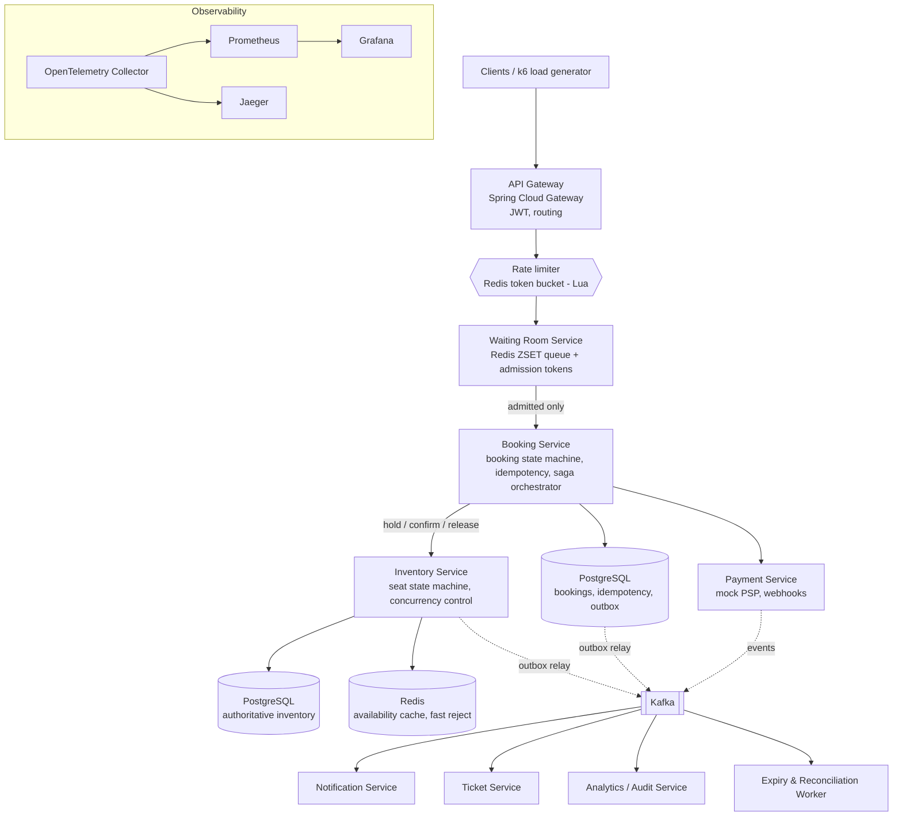
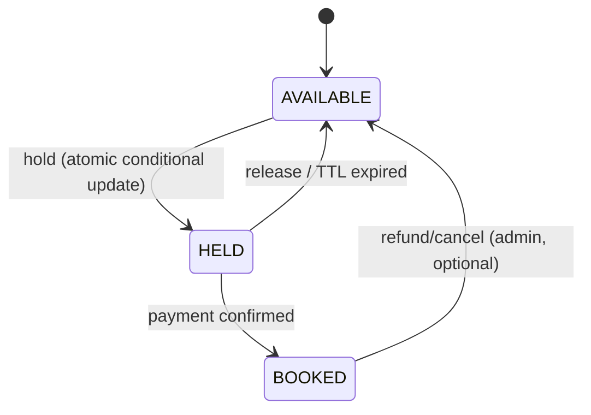
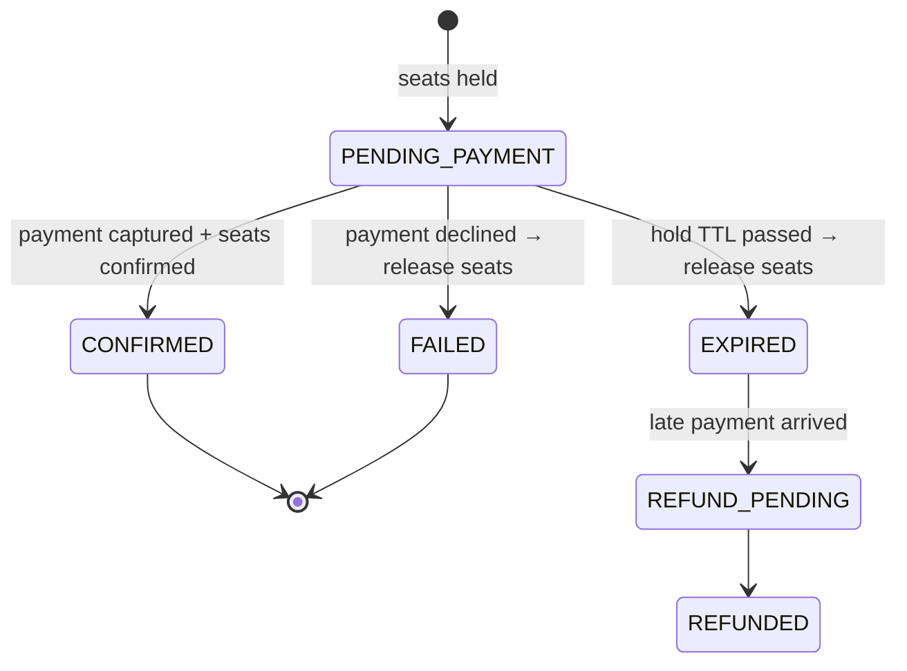
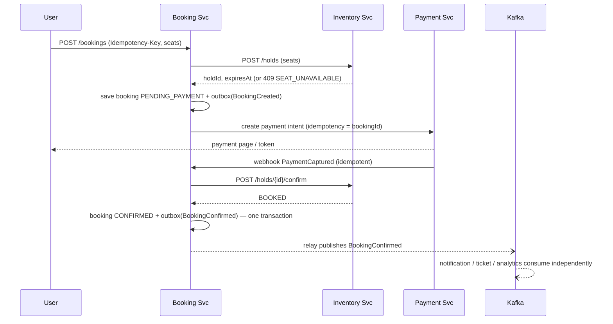

# Distributed High-Concurrency Ticket Reservation System — Master Plan

> **One-line goal:** Thousands of users try to reserve the same limited seats at the same moment, and the system **never oversells, never double-books, never double-charges**, and proves it under load and failure.

This document is the master plan: **what** to build, **how** to build it, and **why** that way. It is organised into phases; each phase is split into small, independently finishable parts (IDs like `P1.3`). Every completed part gets an entry in [`DEVELOPMENT_LOG.md`](DEVELOPMENT_LOG.md), and every significant decision gets an ADR in [`adr/`](adr/).

---

## Table of contents

1. [Project framing](#1-project-framing)
2. [Requirements](#2-requirements)
3. [Capacity estimation](#3-capacity-estimation)
4. [High-Level Design (HLD)](#4-high-level-design-hld)
5. [Low-Level Design (LLD) principles](#5-low-level-design-lld-principles)
6. [Technology choices and alternatives](#6-technology-choices-and-alternatives)
7. [Repository layout](#7-repository-layout)
8. [Phased roadmap](#8-phased-roadmap)
9. [Testing strategy](#9-testing-strategy)
10. [Final demonstration script](#10-final-demonstration-script)
11. [Risks and mitigations](#11-risks-and-mitigations)
12. [Working rules](#12-working-rules)

---

## 1. Project framing

This is **not** "a ticket booking app". It is a **high-concurrency inventory and reservation platform**. The business domain is deliberately simple so that engineering effort goes into the hard parts.

| Area | Priority | Reason |
|---|---|---|
| Seat inventory & reservation engine | **Extremely high** | The core invariant (no oversell) lives here |
| Concurrency control | **Extremely high** | The main interview/viva talking point |
| Load testing & correctness proof | **Extremely high** | Claims without numbers are worthless |
| Virtual waiting room & rate limiting | Very high | Backpressure and load shedding |
| Payment orchestration (Saga) | Very high | Distributed consistency without 2PC |
| Event-driven workflow (Outbox + Kafka) | Very high | Decoupling and the dual-write problem |
| Failure recovery & chaos testing | Very high | Proves reliability, not just happy path |
| Observability | High | Makes behaviour visible in the demo |
| Auth, event management, search | Low | Minimal, just enough to function |
| Frontend | Low | A thin seat-map page at most; the demo is a load test + Grafana |

**Explicitly out of scope:** coupons, reviews, food ordering, posters, user profiles, admin dashboards, real payment gateways, fancy UI.

---

## 2. Requirements

### 2.1 Functional

| ID | Requirement |
|---|---|
| F1 | List on-sale events and view a seat map with live availability |
| F2 | Hold one or more seats atomically (all-or-nothing) for a fixed TTL (5 min) |
| F3 | Release a hold explicitly, or automatically on TTL expiry |
| F4 | Create a booking from a hold and pay for it |
| F5 | On payment success → seats become `BOOKED`; on failure/timeout → seats released |
| F6 | Retried requests (same `Idempotency-Key`) return the original result |
| F7 | During a hot sale, users wait in a virtual queue and are admitted in batches |
| F8 | After confirmation: ticket generated, notification sent, analytics/audit recorded — asynchronously |

### 2.2 Non-functional (the real requirements)

| ID | Requirement | Target |
|---|---|---|
| N1 | **Zero oversell / zero double booking** | 0, verified by invariant SQL after every load test |
| N2 | Zero duplicate charges | 0 per booking |
| N3 | Hold latency under load | p95 < 250 ms, p99 < 500 ms at admitted traffic |
| N4 | Throughput at inventory service | ≥ 3,000 hold attempts/s on a laptop-scale cluster |
| N5 | Availability | Booking continues when one instance of any stateless service dies |
| N6 | Durability | No confirmed booking is lost; no event is lost (at-least-once + idempotent consumers) |
| N7 | Fairness | Waiting room admits FIFO by arrival time |
| N8 | Observability | Every request traceable end-to-end; business metrics on dashboards |

### 2.3 Core invariants (stated formally — used by tests)

1. For every `(event_id, seat_code)` there is **at most one** active hold or booking.
2. `count(BOOKED seats) == count(seats in CONFIRMED bookings)` per event.
3. Every `CONFIRMED` booking has exactly one `CAPTURED` payment; every `CAPTURED` payment belongs to a `CONFIRMED` booking or a `REFUNDED` record.
4. A seat in `HELD` state always has a non-null, unexpired-or-expirable `hold_expires_at`.

---

## 3. Capacity estimation

Back-of-envelope numbers that justify the design (to be validated in P9).

| Quantity | Assumption | Result |
|---|---|---|
| Hot-event arrivals | 100,000 users in 30 s | ~3,300 arrivals/s at the edge |
| Waiting-room polling | each queued user polls every 5 s | ~20,000 req/s of cheap Redis reads → must not touch Postgres |
| Admitted sessions | cap of 2,000 concurrent | bounded load on booking path |
| Hold attempts | each admitted user tries ~3 times (conflicts) over ~60 s | ~100 attempts/s steady, bursts to ~3,000/s at sale open |
| Seats | 50,000 seats × ~200 B row | ~10 MB → whole seat table fits in memory |
| Bookings | ~50,000 per hot event | trivial storage; contention, not volume, is the problem |
| Kafka events | ~5 events per booking | ~250k events per hot event; tiny for Kafka |

**Conclusion:** the bottleneck is **row-level contention on hot seats**, not storage or bandwidth. That is why the design focuses on short atomic transactions, admission control and partitioning by section rather than on big-data tooling.

---

## 4. High-Level Design (HLD)

### 4.1 Architecture



### 4.2 Services and responsibilities

| Service | Owns data | Responsibility | Scales by |
|---|---|---|---|
| **api-gateway** | none | Routing, JWT validation, rate limiting, correlation IDs | Stateless replicas |
| **waiting-room-service** | Redis queue | Enqueue, position, admission tokens, admission rate control | Stateless + Redis |
| **booking-service** | `bookings`, `idempotency_keys`, `outbox` | Booking lifecycle, saga orchestration, idempotency | Stateless replicas |
| **inventory-service** | `events`, `seat_inventory`, `holds`, `outbox` | Seat state machine, holds, confirm/release, expiry | Replicas + partitioning by section |
| **payment-service** | `payments` | Mock payment provider: intents, capture, refund, webhooks with configurable failure/latency | Stateless replicas |
| **notification-service** | `processed_events` | Consume `BookingConfirmed` → send (log/mail-catcher) | Kafka consumer group |
| **ticket-service** | `tickets` | Generate QR/ticket payload per confirmed seat | Kafka consumer group |
| **analytics-service** | `booking_stats` | Aggregates, audit trail | Kafka consumer group |

**Database-per-service** (logical: separate schemas in one Postgres instance for laptop practicality; separable later). No service reads another service's tables.

### 4.3 Seat state machine



### 4.4 Booking state machine



### 4.5 Main flow — hold → pay → confirm (Saga, orchestrated)



Compensations: payment declined → `release hold`; confirm fails transiently → retry with backoff; hold expired before payment → `refund` (late-payment path); repeated failure → DLQ + reconciliation job.

### 4.6 Data model (initial)

```mermaid
erDiagram
    EVENTS ||--o{ SEAT_INVENTORY : has
    EVENTS ||--o{ HOLDS : has
    HOLDS ||--o{ SEAT_INVENTORY : locks
    BOOKINGS ||--|| HOLDS : "references (by id, cross-service)"
    BOOKINGS ||--o{ PAYMENTS : "paid by (cross-service)"
    EVENTS { uuid id PK; string event_code; string status; timestamptz starts_at }
    SEAT_INVENTORY { uuid id PK; uuid event_id; string section; string seat_code; string status; uuid hold_id; timestamptz hold_expires_at; bigint version }
    HOLDS { uuid id PK; uuid event_id; uuid user_id; string status; timestamptz expires_at }
    BOOKINGS { uuid id PK; uuid user_id; uuid hold_id; string status; numeric amount; bigint version }
    IDEMPOTENCY_KEYS { string key PK; uuid user_id; string request_hash; string status; jsonb response; timestamptz expires_at }
    OUTBOX { uuid id PK; string aggregate_type; uuid aggregate_id; string event_type; jsonb payload; timestamptz created_at; timestamptz published_at }
    PAYMENTS { uuid id PK; uuid booking_id UK; string status; numeric amount; string provider_ref }
    PROCESSED_EVENTS { uuid event_id PK; string consumer; timestamptz processed_at }
```

### 4.7 Kafka topics

| Topic | Key | Producers | Consumers | Why this key |
|---|---|---|---|---|
| `booking.events` | `bookingId` | booking-service (outbox) | notification, ticket, analytics | Per-booking ordering (Created → Confirmed) |
| `inventory.events` | `eventId:section` | inventory-service (outbox) | analytics, cache updater | Spreads hot events across partitions |
| `payment.events` | `bookingId` | payment-service | booking-service | Same key as booking → ordered with booking |
| `*.retry.{1m,5m}` / `*.dlq` | same | consumers | retry consumers / ops | Non-blocking retries, poison-message isolation |

---

## 5. Low-Level Design (LLD) principles

Each service uses **hexagonal (ports & adapters) layering** — already started in `inventory-service`:

```
api/            → controllers, request/response DTOs, exception mapping (adapters in)
application/    → use cases, transaction boundaries, orchestration
domain/         → entities, value objects, state machines, domain exceptions (no Spring)
infrastructure/ → JPA repositories, Redis, Kafka, HTTP clients (adapters out)
```

**Why:** the domain (seat/booking rules) is testable without a database, and infrastructure (e.g. the locking strategy) can be swapped — which we need for the concurrency comparison.

Design patterns that will be **deliberately used and documented** (each shows up in the LLD write-up with a class diagram):

| Pattern | Where | Purpose |
|---|---|---|
| **State** | `Seat`, `Booking` | Legal transitions enforced in one place; illegal ones throw |
| **Strategy** | `SeatLockingStrategy` (pessimistic / optimistic / conditional-update / Redis-lock / Redis-Lua) | Swap concurrency approach by config to benchmark them |
| **Repository** | all persistence | Domain independent of JPA/SQL |
| **Saga (Orchestrator)** | `BookingSaga` | Multi-step distributed transaction with compensations |
| **Transactional Outbox** | booking, inventory | Atomic state change + event |
| **Idempotent Receiver** | Kafka consumers, webhooks | Safe redelivery |
| **Template Method** | `IdempotentEventConsumer` base class | Dedup + metrics + error handling around `handle()` |
| **Circuit Breaker / Retry / Bulkhead** | inter-service clients (Resilience4j) | Fail fast, avoid cascading failure |
| **Token Bucket** | rate limiter (Redis Lua) | Smooth burst control |
| **Factory** | event envelope creation | Consistent event metadata (id, type, version, traceId) |

SOLID checkpoints per part: single-responsibility use cases (`CreateHoldUseCase`, `ConfirmHoldUseCase`, …), interfaces for every outbound port, no domain class depending on Spring.

---

## 6. Technology choices and alternatives

| Concern | Choice | Alternatives considered | Why this one |
|---|---|---|---|
| Language/framework | **Java 21 + Spring Boot 3** | Go, Node.js, Kotlin | Mature transaction management, Resilience4j, Spring Kafka; virtual threads for high concurrency; industry-standard for backend interviews |
| Source of truth | **PostgreSQL 16** | MySQL, MongoDB, Redis-only | ACID, row-level locks, `SKIP LOCKED`, conditional updates; Redis-only risks losing holds on failover (see ADR 001) |
| Fast state / queue | **Redis 7** | Memcached, Hazelcast | Atomic Lua scripts, sorted sets for queues, TTLs, single-threaded atomicity |
| Messaging | **Kafka (KRaft)** | RabbitMQ, Redis Streams, SQS | Partitioned ordered log, replay, consumer groups, consumer-lag metrics; the de-facto choice for event-driven backends |
| Outbox relay | **Polling publisher** first, **Debezium CDC** as stretch | Kafka transactions only | Polling is simple and explainable; CDC removes polling load — shown as an upgrade path |
| Gateway | **Spring Cloud Gateway** | Kong, NGINX, Envoy | Same stack, programmable filters for rate limiting and admission-token checks |
| Resilience | **Resilience4j** | Hystrix (dead), Istio | Lightweight, Micrometer-integrated |
| Migrations | **Flyway** | Liquibase | Plain SQL, simple |
| Tests | **JUnit 5 + Testcontainers** | H2 in-memory DB | Concurrency semantics must be tested on real Postgres/Redis/Kafka; H2 locking differs |
| Load tests | **k6** | JMeter, Gatling | Scriptable JS, easy thresholds, Prometheus output |
| Observability | **OpenTelemetry + Prometheus + Grafana + Jaeger** | ELK, Datadog | Open standard, free, vendor-neutral |
| Chaos | **Toxiproxy + docker/k8s kill** | Chaos Mesh | Simple, deterministic fault injection |
| Deployment | **Docker Compose** (dev) → **Kubernetes (kind) + Helm** (final) | Docker Swarm, Nomad | Compose for speed; K8s to demo replicas, HPA, self-healing |

---

## 7. Repository layout (target)

```
.
├── pom.xml                       # parent Maven multi-module build
├── common/                       # event envelope, shared DTOs, idempotency & outbox libs
├── api-gateway/
├── waiting-room-service/
├── booking-service/
├── inventory-service/            # exists
├── payment-service/
├── notification-service/
├── ticket-service/
├── analytics-service/
├── load-tests/                   # k6 scripts + invariant checker
├── chaos/                        # toxiproxy configs, failure scripts
├── deploy/
│   ├── docker-compose.yml
│   ├── observability/            # prometheus, grafana dashboards, otel collector
│   └── helm/
└── docs/
    ├── PROJECT_PLAN.md           # this file
    ├── DEVELOPMENT_LOG.md        # what was built per phase, and why
    ├── adr/                      # architecture decision records
    ├── hld/                      # diagrams, capacity, flows
    ├── lld/                      # class diagrams per service
    └── results/                  # load and chaos test reports
```

---

## 8. Phased roadmap

Legend: ✅ done · 🔨 partly done · ⬜ not started. Each part should be one small, reviewable change (one or a few commits) with a log entry.

### Phase 0 — Foundations & design baseline 🔨

**Goal:** a buildable skeleton and a written design so every later part has a home.

| Part | Task | Output |
|---|---|---|
| P0.1 ✅ | Inventory service skeleton (Spring Boot, hexagonal packages) | `inventory-service/` |
| P0.2 ✅ | Docker Compose: Postgres, Redis, Kafka (KRaft) | `docker-compose.yml` |
| P0.3 ✅ | Flyway V1 schema + demo event with 100 seats | `V1__initial_schema.sql` |
| P0.4 ✅ | CI pipeline (`mvn verify`) | `.github/workflows/ci.yml` |
| P0.5 ✅ | ADR 001 — PostgreSQL is inventory authority | `docs/adr/001-…` |
| P0.6 ✅ | Master plan + development log (this document) | `docs/PROJECT_PLAN.md`, `docs/DEVELOPMENT_LOG.md` |
| P0.7 ✅ | Convert to Maven multi-module parent + `common` module | root `pom.xml` |
| P0.8 ⬜ | HLD pack: architecture, capacity, flows, ERD in `docs/hld/` | diagrams |
| P0.9 ⬜ | API contracts (OpenAPI) for inventory and booking | `docs/api/*.yaml` |
| P0.10 ⬜ | Testcontainers base test setup; CI runs integration tests | test infra |

**Why first:** multi-module now avoids painful restructuring later; contracts first lets services be built independently.

---

### Phase 1 — Inventory & reservation engine (the heart) 🔨

**Goal:** provably correct seat holds under concurrency, plus a measured comparison of locking approaches.

| Part | Task | Details / why |
|---|---|---|
| P1.1 🔨 | Atomic multi-seat hold | Already: conditional `UPDATE … WHERE status='AVAILABLE'` per seat in one transaction, seats sorted to avoid deadlocks. Add: single batched `UPDATE … WHERE seat_code = ANY(?)` and compare affected-row count to requested count (one round trip instead of N). |
| P1.2 ⬜ | Lazy expiry in claim query | `WHERE status='AVAILABLE' OR (status='HELD' AND hold_expires_at < now())` — correctness no longer depends on the expiry worker being on time. |
| P1.3 ⬜ | Domain state machine | `SeatStatus`/`HoldStatus` transitions in the domain layer; illegal transitions throw. Unit-tested without DB. |
| P1.4 ⬜ | Release hold & confirm hold APIs | `DELETE /holds/{id}`, `POST /holds/{id}/confirm`. Both conditional on `hold_id` + owner + not expired; idempotent (repeat confirm returns same result). |
| P1.5 ⬜ | Seat map read API | `GET /events/{id}/seats` — read path separated from write path (later cached in Redis). |
| P1.6 ⬜ | **Concurrency test suite** | Testcontainers Postgres; 500 threads fight for 1 seat → exactly 1 winner; 2,000 threads for 100 seats → exactly 100; overlapping multi-seat requests → no partial holds. Runs in CI. |
| P1.7 ⬜ | `SeatLockingStrategy` (Strategy pattern) | Implementations: (a) **pessimistic** `SELECT … FOR UPDATE`, (b) **optimistic** `version` check + retry, (c) **conditional update** (current), (d) **Redis distributed lock** (`SET NX PX` + fencing token), (e) **Redis Lua** atomic multi-seat check-and-set. Selected by config. |
| P1.8 ⬜ | Benchmark & ADR 002 | Same k6/JMH scenario against each strategy: throughput, p99, conflict rate, deadlocks, correctness under Redis failure. Write `docs/results/locking-comparison.md` + ADR choosing the production strategy. |
| P1.9 ⬜ | Inventory metrics | `seat_hold_attempts_total`, `seat_hold_conflicts_total`, `hold_latency_seconds` histogram. |

**Key reasoning to document:**
- *Pessimistic* — simple, correct, but holds row locks across the transaction → queueing on hot rows, deadlock risk with multi-seat.
- *Optimistic* — no locks held, but under heavy contention most attempts retry/fail → wasted work.
- *Conditional update* — the database does compare-and-set atomically in one statement; no lock held beyond the statement; losers get `0 rows` instantly. Expected winner.
- *Redis lock* — fast, but a lock is not a source of truth (expiry, GC pauses, failover → needs fencing tokens); adds a second system to the critical path.
- *Redis Lua* — fastest, atomic, but Redis is not durable enough to be the authority → use only as a **fast-reject filter** in front of Postgres (Phase 2).

---

### Phase 2 — Hold expiry, Redis fast path & reconciliation ⬜

**Goal:** expired holds return to stock quickly; hot reads and obvious losers never touch Postgres.

| Part | Task | Details / why |
|---|---|---|
| P2.1 | Expiry worker | Scheduled job: `SELECT … WHERE status='HELD' AND expires_at < now() FOR UPDATE SKIP LOCKED LIMIT 500` → release. `SKIP LOCKED` lets several worker replicas run without blocking each other. Emits `HoldExpired`. |
| P2.2 | ShedLock / leader election (if needed) | Compare "every replica with SKIP LOCKED" vs "single leader". Document choice. |
| P2.3 | Redis availability cache | Per `event:section` hash/bitmap of seat states, updated on hold/release/confirm (via outbox events). Seat map reads served from Redis. |
| P2.4 | Fast-reject Lua script | Before hitting Postgres, Lua atomically checks + marks seats `PENDING` in Redis; if already taken → reject in < 1 ms. Postgres still decides; on Postgres failure Redis mark is rolled back. Shows "cache as filter, DB as authority". |
| P2.5 | Reconciliation job | Periodically compares Redis vs Postgres, repairs drift (Postgres wins). Metric `inventory_drift_total`. |
| P2.6 | Redis-down behaviour | Feature-flagged fallback: skip fast path, go straight to Postgres. Proves Redis is an optimisation, not a dependency for correctness. |

---

### Phase 3 — Booking service & idempotency ⬜

**Goal:** a booking aggregate with a strict lifecycle and exactly-once request semantics.

| Part | Task | Details / why |
|---|---|---|
| P3.1 | `booking-service` skeleton | Own schema, hexagonal layout, Flyway. |
| P3.2 | Booking aggregate + state machine | `PENDING_PAYMENT → CONFIRMED / FAILED / EXPIRED → REFUND_PENDING → REFUNDED`, with optimistic `version`. |
| P3.3 | Inventory client | HTTP client with timeouts, retry (only idempotent calls), circuit breaker, bulkhead (Resilience4j). |
| P3.4 | **Idempotency keys** | Table `idempotency_keys(key, user_id, request_hash, status, response, expires_at)`. Flow: `INSERT … ON CONFLICT DO NOTHING` → if new, process and store response; if existing & completed → return stored response; if existing & in-progress → `409 Retry-After`; if same key with different body → `422`. |
| P3.5 | Idempotency as reusable filter | Packaged in `common` as a Spring interceptor so every mutating endpoint gets it. |
| P3.6 | Tests | Concurrent duplicate requests with the same key → one booking; timed-out client retry → same response. |

**Alternatives to note:** Redis-only idempotency (fast, but lost on eviction/failover → duplicates); unique constraint on natural key (works only when a natural key exists).

---

### Phase 4 — Payment orchestration (Saga) ⬜

**Goal:** money and seats stay consistent across services without distributed transactions.

| Part | Task | Details / why |
|---|---|---|
| P4.1 | `payment-service` (mock PSP) | Payment intents, capture, refund; configurable latency, decline rate, timeout rate, duplicate-webhook rate — so failures can be demonstrated on demand. |
| P4.2 | Payment idempotency | One payment per `bookingId` (unique constraint); provider calls carry idempotency key. Prevents double charge. |
| P4.3 | Webhook handling | Signed webhooks, idempotent receiver, out-of-order safe (state machine ignores stale transitions). |
| P4.4 | **Booking saga orchestrator** | Persisted saga state (step, attempts, next_retry_at). Steps: hold → create intent → await capture → confirm hold → confirm booking. Compensations: release hold, refund. |
| P4.5 | Timeout handling | Payment not captured before hold expiry → cancel intent; capture arrives after expiry → late-payment path → automatic refund + `BookingExpired` event. |
| P4.6 | Crash recovery | Saga state persisted every step; on restart, a recovery job resumes in-flight sagas. Demo: kill booking-service between "payment captured" and "seat confirmed" → system still converges. |
| P4.7 | ADR 003 | Orchestration vs choreography: orchestration chosen for a central, debuggable view of a 5-step money flow; choreography used for side effects (notifications etc.). Also why not 2PC/XA (blocking, poor availability, not supported by Kafka/PSP). |

---

### Phase 5 — Event-driven processing (Outbox + Kafka) ⬜

**Goal:** reliable, decoupled side effects; no lost or duplicated effects.

| Part | Task | Details / why |
|---|---|---|
| P5.1 | Event envelope in `common` | `eventId, eventType, version, aggregateId, occurredAt, traceId, payload` — JSON with a versioned schema. |
| P5.2 | **Transactional outbox** | Outbox row written in the same DB transaction as the state change → solves the dual-write problem. |
| P5.3 | Outbox relay | Polling publisher with `FOR UPDATE SKIP LOCKED`, batch publish, mark `published_at`; idempotent producer (`enable.idempotence=true`, `acks=all`). Cleanup of old rows. |
| P5.4 | Topics & partitioning | Create topics with keys from §4.7; document partition counts and why. |
| P5.5 | `IdempotentEventConsumer` base | Template Method: dedup via `processed_events` (insert in same tx as side effect) → `handle()` → metrics. |
| P5.6 | Notification service | Consumes `BookingConfirmed`, sends to MailHog (local SMTP catcher). Failure here never affects booking. |
| P5.7 | Ticket service | Generates ticket + QR payload per seat. |
| P5.8 | Analytics / audit service | Booking counts, conversion, append-only audit table. |
| P5.9 | Retry topics + DLQ | Non-blocking retries (`retry.1m`, `retry.5m`) then `dlq`; DLQ replay CLI/endpoint. |
| P5.10 | Stretch: Debezium CDC relay | Replace polling with CDC from Postgres WAL; compare latency and DB load. |

**Delivery semantics to explain:** at-least-once delivery + idempotent consumers = effectively-once processing. Why not Kafka exactly-once transactions end-to-end: they don't cover external side effects (email, DB in another service).

---

### Phase 6 — Edge: gateway, auth, rate limiting, virtual waiting room ⬜

**Goal:** protect the core from overload and keep it fair.

| Part | Task | Details / why |
|---|---|---|
| P6.1 | API gateway | Spring Cloud Gateway routes, correlation-ID filter, request size limits. |
| P6.2 | Minimal auth | JWT issued by a tiny auth endpoint (or static keys for load tests); `userId` from token instead of `X-User-Id` header. Intentionally minimal. |
| P6.3 | **Distributed token-bucket rate limiter** | Redis Lua script: refill + take atomically; keys per user (10 req/s on reserve) and per IP (100 req/min). Returns `429` + `Retry-After`. Compare with fixed window / sliding log in ADR. |
| P6.4 | **Virtual waiting room** | `ZADD queue:{eventId} <arrivalTs> <userId>`; `ZRANK` for position; ETA from admission rate. |
| P6.5 | Admission controller | Every second admits N users (`ZPOPMIN`) while `active_sessions < 2,000`; issues a short-lived **signed admission token** (JWT/HMAC) the gateway verifies statelessly. |
| P6.6 | Session lifecycle | Active sessions expire after booking or inactivity → slots freed for next users. |
| P6.7 | Load shedding & backpressure | Gateway rejects fast when downstream circuit is open or queue too long; adaptive admission rate based on inventory p99 latency (feedback loop). |
| P6.8 | Bot/duplicate protection | One queue entry per user, token bound to user + event. |

---

### Phase 7 — Hot-event scaling & partitioning ⬜

**Goal:** show reasoning for the case where one event receives ~all traffic.

| Part | Task | Details / why |
|---|---|---|
| P7.1 | Add `section` to inventory | Seats grouped by section; keys become `eventId:section`. |
| P7.2 | Section-aware routing | Kafka keys, Redis keys (`{event:section}` hash tags for Redis Cluster slots), inventory request routing. |
| P7.3 | Postgres partitioning | `seat_inventory` LIST/HASH partitioned by event (and section for hot events); measure effect on contention and vacuum. |
| P7.4 | Connection pool & thread tuning | HikariCP sizing (`cores*2+spindles` reasoning), virtual threads, Postgres `max_connections`. |
| P7.5 | Read/write split | Seat map reads from Redis / read replica; writes to primary only. |
| P7.6 | Experiment report | Normal event (500 users) vs hot event (50k users), before/after partitioning. ADR 006. |

---

### Phase 8 — Observability ⬜

**Goal:** every claim visible on a dashboard; every request traceable.

| Part | Task | Details / why |
|---|---|---|
| P8.1 | OpenTelemetry Java agent + Collector | Traces across gateway → booking → inventory → Kafka → consumers (context propagated in Kafka headers). |
| P8.2 | Prometheus + Grafana | Scrape `/actuator/prometheus`; provisioned dashboards as code. |
| P8.3 | Business metrics | `booking_requests_total`, `booking_success_rate`, `seat_lock_conflicts`, `payment_failure_rate`, `queue_depth`, `admitted_sessions`, `oversold_seats` (must be 0), `outbox_lag_seconds`, Kafka consumer lag. |
| P8.4 | Latency SLOs | p50/p95/p99 histograms per endpoint; SLO panels and burn-rate alerts. |
| P8.5 | Jaeger tracing | Show one booking's full trace in the demo. |
| P8.6 | Structured JSON logs | With `traceId`, `bookingId`, `userId`. |
| P8.7 | Alerts | Oversold > 0, DLQ non-empty, consumer lag high, circuit open. |

---

### Phase 9 — Load testing & correctness proof ⬜

**Goal:** numbers that prove N1–N4.

| Part | Task | Details / why |
|---|---|---|
| P9.1 | k6 scenarios | (a) 20,000 users vs 1,000 seats, (b) 50,000 users vs 5,000 seats via waiting room, (c) steady-state mixed traffic, (d) spike. |
| P9.2 | Invariant checker | SQL/script run after each test: duplicate seats = 0, booked seats = confirmed booking seats, payments ↔ bookings consistent. Fails the run if violated. |
| P9.3 | Results reports | `docs/results/load-*.md` with charts: throughput, p50/p95/p99, success/reject counts, oversell = 0. |
| P9.4 | CI smoke load test | Small k6 run in CI with thresholds so regressions are caught. |
| P9.5 | Bottleneck analysis | Use traces + `pg_stat_statements` to find and fix the top bottleneck; document before/after. |

---

### Phase 10 — Failure & chaos testing ⬜

**Goal:** prove reliability, not just correctness on the happy path.

| Part | Experiment | Expected result |
|---|---|---|
| P10.1 | Kill a booking-service replica mid-load | Others keep serving; in-flight sagas resume; 0 oversell |
| P10.2 | Kill inventory-service replica | Retries + circuit breaker; no partial holds |
| P10.3 | Redis down | Fast path disabled; bookings continue via Postgres; waiting room degrades gracefully |
| P10.4 | Kafka down | Bookings still succeed; outbox grows; drains on recovery with no loss |
| P10.5 | Inject duplicate Kafka messages | Consumers dedupe; one email, one ticket |
| P10.6 | Payment webhook duplicated / out of order / delayed past expiry | No double charge; late payment refunded |
| P10.7 | Network latency/partition (Toxiproxy) | Timeouts fire, breakers open, system recovers |
| P10.8 | Crash between payment capture and seat confirm | Saga recovery converges to CONFIRMED |
| P10.9 | Report | `docs/results/chaos.md` — experiment, hypothesis, observation, metric screenshot. |

---

### Phase 11 — Deployment ⬜

| Part | Task | Details / why |
|---|---|---|
| P11.1 | Dockerfiles (layered, non-root, JVM tuned) | Small, reproducible images |
| P11.2 | Full-stack Docker Compose with observability | One command to run everything locally |
| P11.3 | Kubernetes on kind + Helm charts | Deployments, Services, ConfigMaps, Secrets |
| P11.4 | Probes & graceful shutdown | Readiness/liveness; drain in-flight requests on SIGTERM |
| P11.5 | HPA | Scale booking/inventory on CPU or custom metric (request rate) |
| P11.6 | CI/CD | Build, test, image build; optional deploy to kind in CI |

---

### Phase 12 — Documentation, demo & polish ⬜

| Part | Task |
|---|---|
| P12.1 | Final HLD document (`docs/hld/`) — architecture, flows, scaling, trade-offs |
| P12.2 | Final LLD document (`docs/lld/`) — class diagrams per service, patterns, SOLID |
| P12.3 | Polished README with architecture diagram, quickstart, results summary |
| P12.4 | Demo script (§10) rehearsed and recorded |
| P12.5 | Viva/interview Q&A sheet: "why not X?" for every major decision |
| P12.6 | Optional thin seat-map UI (only if time remains) |

---

### Suggested timeline (single developer, ~16 weeks; compress for a team)

| Weeks | Phases |
|---|---|
| 1 | P0 |
| 2–4 | P1 (most important — don't rush) |
| 5 | P2 |
| 6 | P3 |
| 7–8 | P4 |
| 9–10 | P5 |
| 11 | P6 |
| 12 | P8 (start observability early enough to use it in P9) |
| 13 | P9 + P7 |
| 14 | P10 |
| 15 | P11 |
| 16 | P12 |

**If time runs short, cut in this order:** P12.6 UI → P5.10 Debezium → P7.3 partitioning → P11.5 HPA → P2.5 reconciliation. **Never cut:** P1, P3.4, P4, P5.2, P9, P10.

### Optional team split (if working with 4 people)

| Person | Ownership |
|---|---|
| 1 | P1, P2, P7 — inventory, concurrency, Redis, partitioning |
| 2 | P3, P4, P5 — booking, payment saga, outbox, Kafka |
| 3 | P6, P9 — gateway, rate limiting, waiting room, load testing |
| 4 | P8, P10, P11 — observability, chaos, deployment, notifications |

---

## 9. Testing strategy

| Layer | Tool | What it proves |
|---|---|---|
| Unit | JUnit 5 | State machines, rate-limit math, idempotency logic |
| Integration | Testcontainers (Postgres, Redis, Kafka) | Real locking semantics, outbox, consumers |
| Concurrency | Multi-threaded Testcontainers tests | Exactly-N winners, no partial holds, no deadlocks |
| Contract | OpenAPI + Spring Cloud Contract (optional) | Services agree on APIs |
| Load | k6 | Throughput, latency, oversell = 0 |
| Chaos | Toxiproxy, container kill | Recovery and convergence |
| Invariants | SQL checker | Formal invariants from §2.3 after every run |

---

## 10. Final demonstration script

1. Show architecture diagram (30 s).
2. Reset: 1,000 seats available. Open Grafana dashboard.
3. Fire k6: 20,000 concurrent users through the waiting room.
4. Watch live: queue depth, admitted sessions, hold conflicts, p95/p99, booking success rate.
5. Mid-run: `kill` a booking-service replica → traffic continues.
6. Mid-run: inject duplicate Kafka messages → one email per booking.
7. End result:
   ```
   Seats available:      0
   Successful bookings:  1,000
   Rejected attempts:    19,000
   Oversold seats:       0
   Duplicate payments:   0
   p50 / p95 / p99:      xx / xx / xx ms
   ```
8. Open Jaeger: one booking's trace end-to-end.
9. Show the locking-strategy comparison chart and explain the choice.

---

## 11. Risks and mitigations

| Risk | Mitigation |
|---|---|
| Scope creep into features | §1 priority table; cut list in §8 |
| Laptop can't run full stack under load | Lower replica counts, run load generator separately, scale numbers proportionally and report honestly |
| Flaky concurrency tests | Deterministic seeds, CountDownLatch start barrier, assert invariants not timings |
| Too many services to maintain | Shared `common` module, identical layout, one Compose file |
| Redis/Kafka complexity hides bugs | Postgres remains the authority; invariant checker after every run |

---

## 12. Working rules

1. **Git identity:** all commits and pushes go through the project owner's own GitHub account and configured git identity only. No third-party co-author trailers or tool attribution lines in commits or PR descriptions.
2. **Documentation per change:** every part (`Px.y`) that is completed gets an entry in [`DEVELOPMENT_LOG.md`](DEVELOPMENT_LOG.md): what was built, where, why, and which alternatives were rejected. Significant decisions also get an ADR.
3. **Small steps:** one part ≈ one focused change; tests and docs in the same change.
4. **Conventional commits:** `feat(inventory): …`, `test(booking): …`, `docs: …`, `chore(ci): …`.
5. **Correctness first:** no part touching inventory, booking or payment is "done" without a concurrency/idempotency test.
