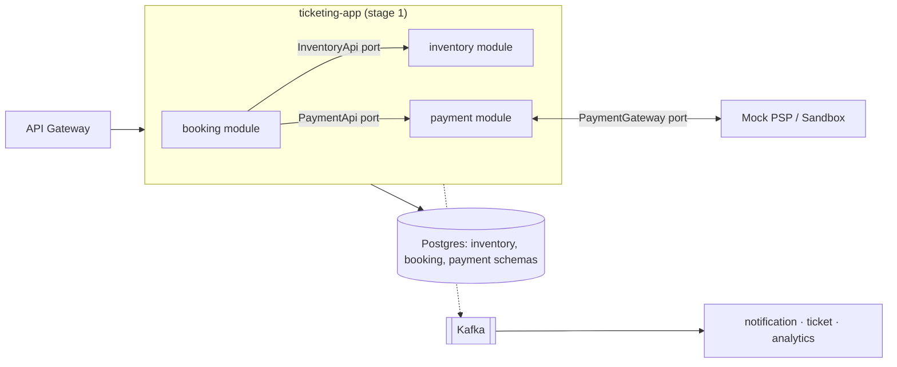
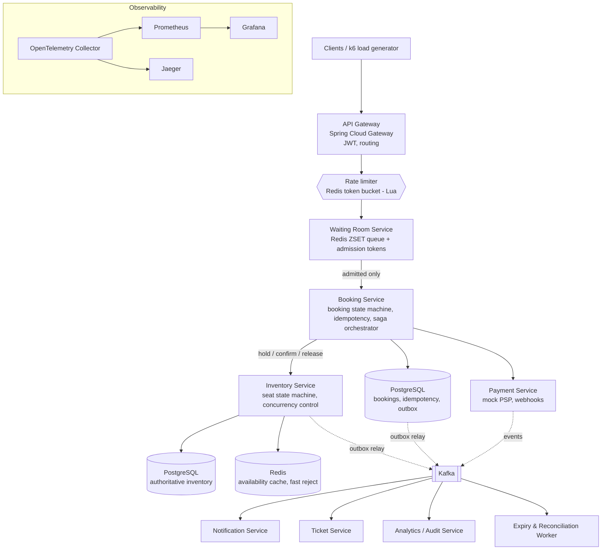
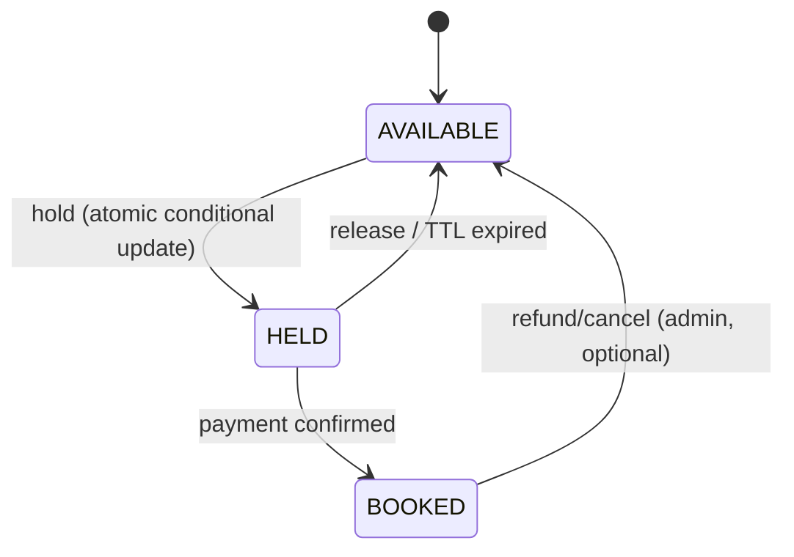
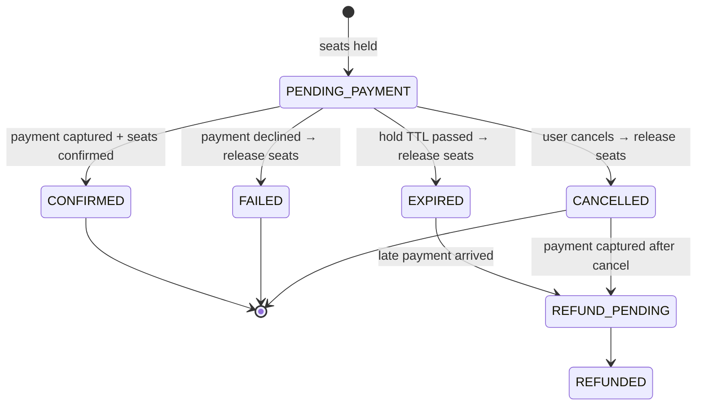
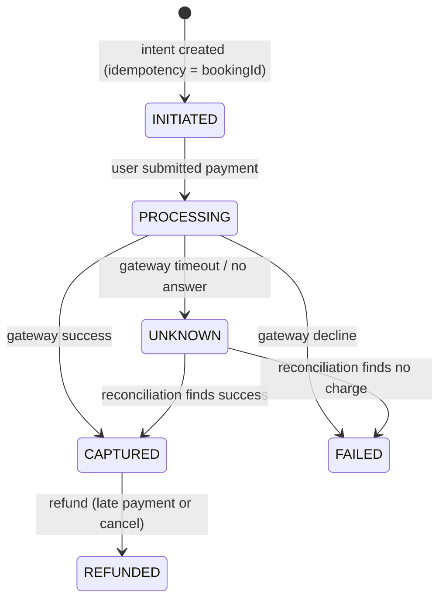
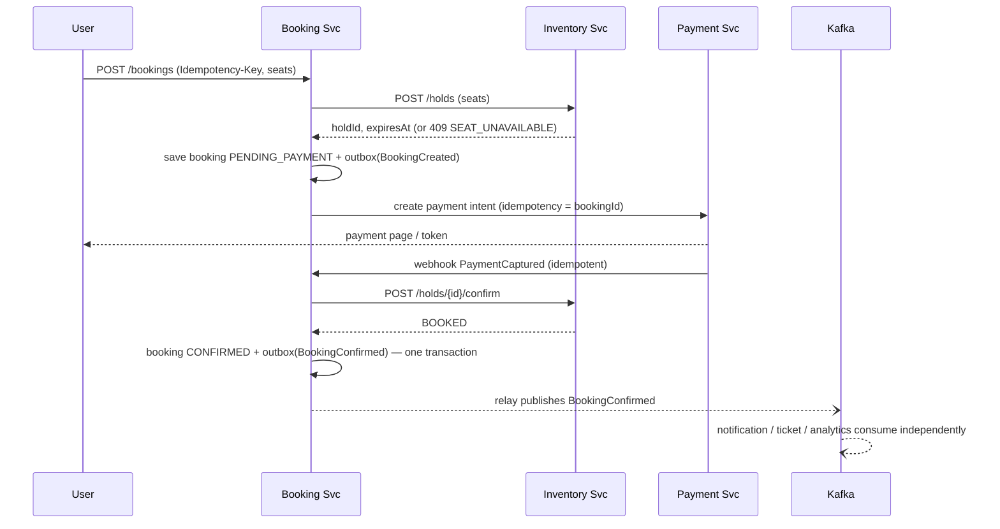
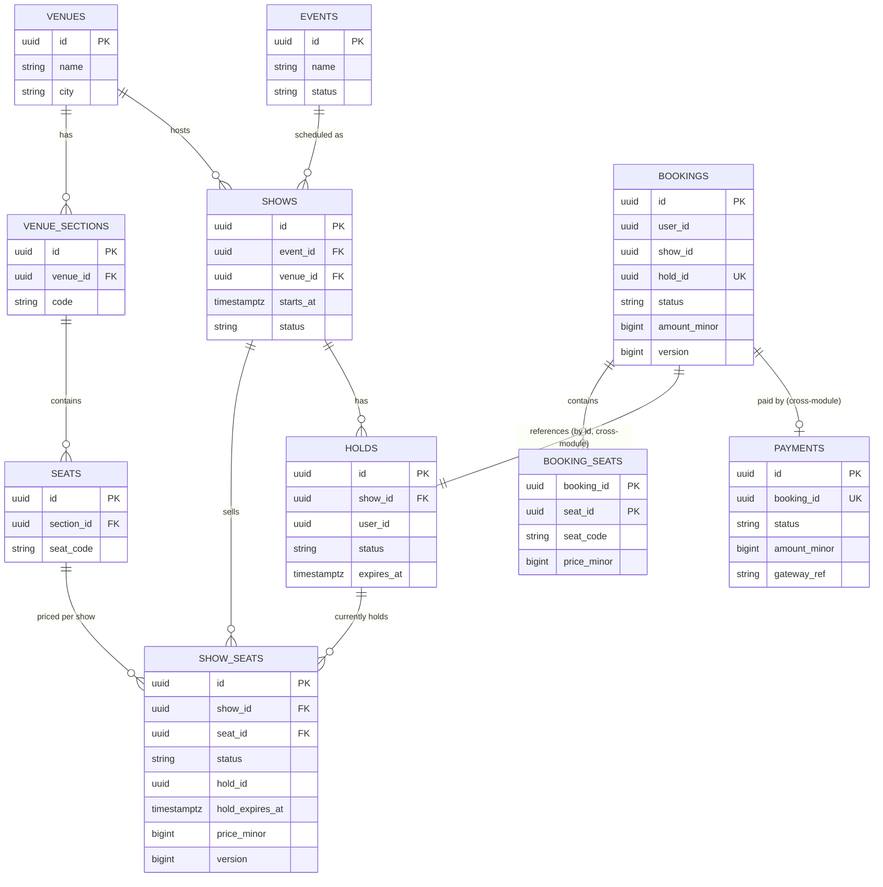

# Distributed High-Concurrency Ticket Reservation System — Master Plan

> **One-line goal:** Thousands of users try to reserve the same limited seats at the same moment, and the system **never oversells, never double-books, never double-charges**, and proves it under load and failure.

This document is the master plan: **what** to build, **how** to build it, and **why** that way. It is organised into phases; each phase is split into small, independently finishable parts (IDs like `P1.3`). Every completed part gets an entry in [`DEVELOPMENT_LOG.md`](DEVELOPMENT_LOG.md), and every significant decision gets an ADR in [`adr/`](adr/).

---

## Table of contents

1. [Project framing](#1-project-framing)
2. [Requirements](#2-requirements)
3. [Capacity estimation](#3-capacity-estimation)
4. [High-Level Design (HLD)](#4-high-level-design-hld)
5. [Low-Level Design (LLD) principles](#5-low-level-design-lld-principles)
6. [Technology choices and alternatives](#6-technology-choices-and-alternatives)
7. [Repository layout](#7-repository-layout)
8. [Phased roadmap](#8-phased-roadmap)
9. [Testing strategy](#9-testing-strategy)
10. [Final demonstration script](#10-final-demonstration-script)
11. [Risks and mitigations](#11-risks-and-mitigations)
12. [Working rules](#12-working-rules)

---

## 1. Project framing

This is **not** "a ticket booking app". It is a **high-concurrency inventory and reservation platform**. The business domain is deliberately simple so that engineering effort goes into the hard parts.

| Area | Priority | Reason |
|---|---|---|
| Seat inventory & reservation engine | **Extremely high** | The core invariant (no oversell) lives here |
| Concurrency control | **Extremely high** | The main interview/viva talking point |
| Load testing & correctness proof | **Extremely high** | Claims without numbers are worthless |
| Virtual waiting room & rate limiting | Very high | Backpressure and load shedding |
| Payment orchestration (Saga) | Very high | Distributed consistency without 2PC |
| Event-driven workflow (Outbox + Kafka) | Very high | Decoupling and the dual-write problem |
| Failure recovery & chaos testing | Very high | Proves reliability, not just happy path |
| Observability | High | Makes behaviour visible in the demo |
| Auth, admin APIs, booking history | Low | Thin: registration/login with roles, admin CRUD for venues/events/shows, a user's booking list |
| Live seat updates (WebSocket) | Low | Nice for the demo; never on the correctness path |
| Frontend | Low | A thin seat-map page at most; the demo is a load test + Grafana |

**Explicitly out of scope:** coupons, reviews, food ordering, posters, rich user profiles, admin dashboards (UI), live-mode payments, fancy UI. A payment gateway **sandbox (test mode)** is in scope (P4.1).

**Plan revision (2026-11-16):** after comparing this plan with the TicketFlow blueprint, both partners agreed to adopt its Show/Venue domain model, its payment `UNKNOWN` state with reconciliation, a sandbox gateway, the thin user/admin features and early SRS/UML documents. The core is built **modular-monolith first** ([ADR 002](adr/002-modular-monolith-first.md)). Every change made by this revision is tagged *(rev)* below.

---

## 2. Requirements

### 2.1 Functional

| ID | Requirement |
|---|---|
| F1 | List on-sale events and their **shows** (one event, many dates/venues), and view a show's seat map with live availability *(rev)* |
| F2 | Hold one or more seats of a show atomically (all-or-nothing) for a fixed TTL (5 min) |
| F3 | Release a hold explicitly, or automatically on TTL expiry |
| F4 | Create a booking from a hold and pay for it |
| F5 | On payment success → seats become `BOOKED`; on failure/timeout → seats released |
| F6 | Retried requests (same `Idempotency-Key`) return the original result |
| F7 | During a hot sale, users wait in a virtual queue and are admitted in batches |
| F8 | After confirmation: ticket generated, notification sent, analytics/audit recorded — asynchronously |
| F9 | A user can cancel a pending booking (seats released) and list their own bookings *(rev)* |
| F10 | An admin can create venues (sections, seat layout), events and shows *(rev)* |
| F11 | A payment whose outcome is unknown (gateway timeout) is resolved automatically by reconciliation *(rev)* |
| F12 | Clients viewing a seat map receive live seat-status updates (WebSocket) *(rev, low priority)* |

### 2.2 Non-functional (the real requirements)

| ID | Requirement | Target |
|---|---|---|
| N1 | **Zero oversell / zero double booking** | 0, verified by invariant SQL after every load test |
| N2 | Zero duplicate charges | 0 per booking |
| N3 | Hold latency under load | p95 < 250 ms, p99 < 500 ms at admitted traffic |
| N4 | Throughput at inventory service | ≥ 3,000 hold attempts/s on a laptop-scale cluster |
| N5 | Availability | Booking continues when one instance of any stateless service dies |
| N6 | Durability | No confirmed booking is lost; no event is lost (at-least-once + idempotent consumers) |
| N7 | Fairness | Waiting room admits FIFO by arrival time |
| N8 | Observability | Every request traceable end-to-end; business metrics on dashboards |

### 2.3 Core invariants (stated formally — used by tests)

1. For every `(show_id, seat_id)` there is **at most one** active hold or booking.
2. `count(BOOKED show seats) == count(booking_seats of CONFIRMED bookings)` per show.
3. Every `CONFIRMED` booking has exactly one `CAPTURED` payment; every `CAPTURED` payment belongs to a `CONFIRMED` booking or a `REFUNDED` record.
4. A seat in `HELD` state always has a non-null, unexpired-or-expirable `hold_expires_at`.
5. No payment stays `UNKNOWN` longer than the reconciliation window (default 15 min) *(rev)*.

---

## 3. Capacity estimation

Back-of-envelope numbers that justify the design (to be validated in P9).

| Quantity | Assumption | Result |
|---|---|---|
| Hot-event arrivals | 100,000 users in 30 s | ~3,300 arrivals/s at the edge |
| Waiting-room polling | each queued user polls every 5 s | ~20,000 req/s of cheap Redis reads → must not touch Postgres |
| Admitted sessions | cap of 2,000 concurrent | bounded load on booking path |
| Hold attempts | each admitted user tries ~3 times (conflicts) over ~60 s | ~100 attempts/s steady, bursts to ~3,000/s at sale open |
| Seats | 50,000 seats × ~200 B row | ~10 MB → whole seat table fits in memory |
| Bookings | ~50,000 per hot event | trivial storage; contention, not volume, is the problem |
| Kafka events | ~5 events per booking | ~250k events per hot event; tiny for Kafka |

**Conclusion:** the bottleneck is **row-level contention on hot seats**, not storage or bandwidth. That is why the design focuses on short atomic transactions, admission control and partitioning by section rather than on big-data tooling.

---

## 4. High-Level Design (HLD)

> Summary only. The full HLD (architecture, capacity, every request flow incl. failures, data model, consistency & failure model) lives in [`hld/`](hld/README.md).

### 4.0 Deployment stages *(rev)*

The diagram in §4.1 is the **target** topology. It is reached in two stages ([ADR 002](adr/002-modular-monolith-first.md)):

| Stage | Core (inventory + booking + payment) | Edge and consumers | When |
|---|---|---|---|
| **1. Modular monolith** | One deployable, `ticketing-app`, with three Maven modules. Each module has its own schema and its own ports, and ArchUnit enforces the boundaries. | Separate services from the start | P0.14 → P6 |
| **2. Extracted** | `inventory-service` and `payment-service` split out. The in-process port adapters are swapped for HTTP clients (with Resilience4j) and webhooks. | Unchanged | P7.8–P7.9, after measurements justify it |



### 4.1 Architecture



### 4.2 Services and responsibilities

| Service | Owns data | Responsibility | Scales by |
|---|---|---|---|
| **api-gateway** | none | Routing, JWT validation, rate limiting, correlation IDs | Stateless replicas |
| **waiting-room-service** | Redis queue | Enqueue, position, admission tokens, admission rate control | Stateless + Redis |
| **booking-service** | `bookings`, `idempotency_keys`, `outbox` | Booking lifecycle, saga orchestration, idempotency | Stateless replicas |
| **inventory-service** | `venues`, `venue_sections`, `seats`, `events`, `shows`, `show_seats`, `holds`, `outbox` | Catalog (venue layout, events, shows), seat state machine, holds, confirm/release, expiry | Replicas + partitioning by section |
| **payment-service** | `payments`, `refunds` | `PaymentGateway` port with Mock (failure injection) and Sandbox adapters; intents, capture, refund, webhooks; reconciliation of `UNKNOWN` payments | Stateless replicas |
| **notification-service** | `processed_events` | Consume `BookingConfirmed` → send (log/mail-catcher) | Kafka consumer group |
| **ticket-service** | `tickets` | Generate QR/ticket payload per confirmed seat | Kafka consumer group |
| **analytics-service** | `booking_stats` | Aggregates, audit trail | Kafka consumer group |

**Database-per-service** (logical: separate schemas in one Postgres instance for laptop practicality; separable later). No service reads another service's tables. In stage 1 the same rule applies between modules (§4.0).

### 4.3 Seat state machine (per `show_seat`)



### 4.4 Booking state machine



`CANCELLED` is new *(rev)*. Cancelling a booking that is already `CONFIRMED` (a refund before the show) is optional and out of scope for now.

### 4.4b Payment state machine *(rev)*



**Why `UNKNOWN`?** If a gateway call times out, the money may or may not have moved. Treating that as `FAILED` would release seats someone has paid for. Treating it as `CAPTURED` would hand out tickets that were never paid for. `UNKNOWN` records the honest state. A **reconciliation job** (P4.8) then asks the gateway for the real outcome, looking it up by idempotency key, and moves the payment to `CAPTURED` or `FAILED`. While a payment is `UNKNOWN`, its seats stay `HELD` until the hold's normal expiry. If reconciliation later finds `CAPTURED` but the hold has already expired, the existing late-payment refund path runs. No new mechanism is needed, and invariant 3 still holds.

### 4.5 Main flow — hold → pay → confirm (Saga, orchestrated)



Compensations: payment declined → `release hold`; confirm fails transiently → retry with backoff; hold expired before payment → `refund` (late-payment path); repeated failure → DLQ + reconciliation job.

### 4.6 Data model *(rev: Venue / Show model)*

**Catalog vs inventory:** `seats` is the venue's *physical* layout (one row per chair, created once per venue). `show_seats` is the *sellable* inventory: one row per seat **per show**. It is the unit of locking. One event (a concert tour) has many shows (date + venue). Without `shows`, the same chair could not be sold separately for two dates. Full column lists and constraints: [`hld/04-data-model.md`](hld/04-data-model.md).



Also per module: `outbox`, `processed_events`, `idempotency_keys` and `booking_sagas` (see the HLD data model). Money is stored in **minor units** (paise) as `bigint`, so there are no floating-point rounding errors.

### 4.7 Kafka topics

| Topic | Key | Producers | Consumers | Why this key |
|---|---|---|---|---|
| `booking.events` | `bookingId` | booking-service (outbox) | notification, ticket, analytics | Per-booking ordering (Created → Confirmed) |
| `inventory.events` | `showId:section` | inventory-service (outbox) | analytics, cache updater | Spreads hot events across partitions |
| `payment.events` | `bookingId` | payment module/service | booking | Same key as booking → ordered with booking |
| `seat.updates` *(rev)* | `showId` | inventory (from outbox) | WebSocket push (P5.11) | All updates of one show in order |
| `*.retry.{1m,5m}` / `*.dlq` | same | consumers | retry consumers / ops | Non-blocking retries, poison-message isolation |

---

## 5. Low-Level Design (LLD) principles

Each module uses **hexagonal (ports & adapters) layering**, already in place in `inventory/`:

```
api/            → published module port (e.g. InventoryApi) + its DTOs, the only package other modules may use
web/            → controllers, HTTP request/response DTOs, exception mapping (adapters in)
application/    → use cases, transaction boundaries, orchestration
domain/         → entities, value objects, state machines, domain exceptions (no Spring)
infrastructure/ → JPA repositories, Redis, Kafka, HTTP clients (adapters out)
```

**Why:** the domain (seat/booking rules) is testable without a database, and infrastructure (e.g. the locking strategy) can be swapped — which we need for the concurrency comparison.

Design patterns that will be **deliberately used and documented**. The living registry, with the exact class and file for each pattern, why it was used and what the alternative was, is [`lld/DESIGN_PATTERNS.md`](lld/DESIGN_PATTERNS.md). It is updated in the same change that introduces a pattern.

| Pattern | Where | Purpose |
|---|---|---|
| **State** | `ShowSeat`, `Hold`, `Booking`, `Payment` | Legal transitions enforced in one place; illegal ones throw |
| **Strategy** | `SeatLockingStrategy` (pessimistic / optimistic / conditional-update / Redis-lock / Redis-Lua) | Swap concurrency approach by config to benchmark them |
| **Adapter (Ports & Adapters)** | `PaymentGateway` → `MockPaymentGateway`, `SandboxPaymentGateway`; `InventoryApi` → in-process / HTTP adapter *(rev)* | Same core code against a fake PSP, a real sandbox, or a remote service |
| **Repository** | all persistence | Domain independent of JPA/SQL |
| **Facade** | each module's `api` package (`InventoryApi`, `PaymentApi`) *(rev)* | One narrow entry point per module; hides internals, makes extraction a swap |
| **Saga (Orchestrator)** | `BookingSaga` | Multi-step distributed transaction with compensations |
| **Transactional Outbox** | booking, inventory, payment | Atomic state change + event |
| **Idempotent Receiver** | Kafka consumers, webhooks | Safe redelivery |
| **Template Method** | `IdempotentEventConsumer` base class | Dedup + metrics + error handling around `handle()` |
| **Observer (pub/sub)** | domain events → outbox → Kafka → consumers / WebSocket push | Producers don't know their consumers |
| **Chain of Responsibility** | gateway filters (correlation ID → auth → rate limit → admission token) | Each cross-cutting check is one link, ordered by config |
| **Circuit Breaker / Retry / Bulkhead** | inter-service clients (Resilience4j), stage 2 | Fail fast, avoid cascading failure |
| **Token Bucket** | rate limiter (Redis Lua) | Smooth burst control |
| **Factory** | event envelope creation | Consistent event metadata (id, type, version, traceId) |
| **Builder** | test-data builders (`ShowFixture`, `HoldRequestBuilder`) | Readable concurrency tests |

SOLID checkpoints per part: single-responsibility use cases (`CreateHoldUseCase`, `ConfirmHoldUseCase`, …), interfaces for every outbound port, no domain class depending on Spring. Where and how each principle is applied is recorded in [`lld/SOLID.md`](lld/SOLID.md), and code that applies a pattern carries a short Javadoc line that points back to the registry entry.

---

## 6. Technology choices and alternatives

| Concern | Choice | Alternatives considered | Why this one |
|---|---|---|---|
| Language/framework | **Java 21 + Spring Boot 3** | Go, Node.js, Kotlin | Mature transaction management, Resilience4j, Spring Kafka; virtual threads for high concurrency; industry-standard for backend interviews |
| Source of truth | **PostgreSQL 16** | MySQL, MongoDB, Redis-only | ACID, row-level locks, `SKIP LOCKED`, conditional updates; Redis-only risks losing holds on failover (see ADR 001) |
| Fast state / queue | **Redis 7** | Memcached, Hazelcast | Atomic Lua scripts, sorted sets for queues, TTLs, single-threaded atomicity |
| Messaging | **Kafka (KRaft)** | RabbitMQ, Redis Streams, SQS | Partitioned ordered log, replay, consumer groups, consumer-lag metrics; the de-facto choice for event-driven backends |
| Outbox relay | **Polling publisher** first, **Debezium CDC** as stretch | Kafka transactions only | Polling is simple and explainable; CDC removes polling load — shown as an upgrade path |
| Architecture style *(rev)* | **Modular monolith first, extract later** | Microservices from day one, plain monolith | Proves correctness without network noise first; boundaries are kept so extraction is a swap ([ADR 002](adr/002-modular-monolith-first.md)) |
| Payment provider *(rev)* | **`PaymentGateway` port: Mock + Razorpay test mode** | Stripe test mode, mock only | The mock gives deterministic failure injection for tests and chaos; the sandbox proves the adapter against a real API (INR, webhooks, order lookup for reconciliation). Stripe works the same way and can be swapped in |
| Live updates *(rev)* | **WebSocket (STOMP over Spring WebSocket)** | Server-Sent Events, polling | Push to many viewers; STOMP gives per-show topics. SSE is a valid simpler alternative (one-way only) |
| Module boundaries *(rev)* | **Maven modules + ArchUnit** | Spring Modulith | Compile-time boundaries and an explicit rule test; see ADR 002 |
| Gateway | **Spring Cloud Gateway** | Kong, NGINX, Envoy | Same stack, programmable filters for rate limiting and admission-token checks |
| Resilience | **Resilience4j** | Hystrix (dead), Istio | Lightweight, Micrometer-integrated |
| Migrations | **Flyway** | Liquibase | Plain SQL, simple |
| Tests | **JUnit 5 + Testcontainers** | H2 in-memory DB | Concurrency semantics must be tested on real Postgres/Redis/Kafka; H2 locking differs |
| Load tests | **k6** | JMeter, Gatling | Scriptable JS, easy thresholds, Prometheus output |
| Observability | **OpenTelemetry + Prometheus + Grafana + Jaeger** | ELK, Datadog | Open standard, free, vendor-neutral |
| Chaos | **Toxiproxy + docker/k8s kill** | Chaos Mesh | Simple, deterministic fault injection |
| Deployment | **Docker Compose** (dev) → **Kubernetes (kind) + Helm** (final) | Docker Swarm, Nomad | Compose for speed; K8s to demo replicas, HPA, self-healing |

---

## 7. Repository layout (target)

```
.
├── pom.xml                       # parent Maven multi-module build
├── common/                       # event envelope, shared DTOs, idempotency & outbox libs
├── api-gateway/
├── waiting-room-service/
├── inventory/                    # module: catalog + seat inventory (moved from inventory-service in P0.14)
├── booking/                      # module: booking lifecycle, idempotency, saga
├── payment/                      # module: PaymentGateway port + adapters, reconciliation
├── ticketing-app/                # stage-1 deployable that bundles the three modules
├── inventory-service/            # stage-2 extraction (P7.8)
├── payment-service/              # stage-2 extraction (P7.9)
├── notification-service/
├── ticket-service/
├── analytics-service/
├── load-tests/                   # k6 scripts + invariant checker
├── chaos/                        # toxiproxy configs, failure scripts
├── deploy/
│   ├── docker-compose.yml
│   ├── observability/            # prometheus, grafana dashboards, otel collector
│   └── helm/
└── docs/
    ├── PROJECT_PLAN.md           # this file
    ├── DEVELOPMENT_LOG.md        # what was built per phase, and why
    ├── adr/                      # architecture decision records
    ├── srs/                      # SRS, use-case and activity diagrams
    ├── hld/                      # diagrams, capacity, flows
    ├── lld/                      # class diagrams, DESIGN_PATTERNS.md, SOLID.md
    ├── api/                      # OpenAPI contracts
    └── results/                  # load and chaos test reports
```

---

## 8. Phased roadmap

Legend: ✅ done · 🔨 partly done · ⬜ not started. Each part should be one small, reviewable change (one or a few commits) with a log entry.

### Phase 0 — Foundations & design baseline ✅

**Goal:** a buildable skeleton and a written design so every later part has a home.

| Part | Task | Output |
|---|---|---|
| P0.1 ✅ | Inventory service skeleton (Spring Boot, hexagonal packages) | `inventory-service/` |
| P0.2 ✅ | Docker Compose: Postgres, Redis, Kafka (KRaft) | `docker-compose.yml` |
| P0.3 ✅ | Flyway V1 schema + demo event with 100 seats | `V1__initial_schema.sql` |
| P0.4 ✅ | CI pipeline (`mvn verify`) | `.github/workflows/ci.yml` |
| P0.5 ✅ | ADR 001 — PostgreSQL is inventory authority | `docs/adr/001-…` |
| P0.6 ✅ | Master plan + development log (this document) | `docs/PROJECT_PLAN.md`, `docs/DEVELOPMENT_LOG.md` |
| P0.7 ✅ | Convert to Maven multi-module parent + `common` module | root `pom.xml` |
| P0.8 ✅ | HLD pack: architecture, capacity, flows, ERD in `docs/hld/` | diagrams |
| P0.9 ✅ | Design revision after the TicketFlow crosswork: Show/Venue model, booking `CANCELLED`, payment `UNKNOWN` + reconciliation, sandbox gateway, thin admin/history/WebSocket scope, error format; ADR 002 (modular monolith first) *(rev)* | plan, HLD, `docs/adr/002-…` |
| P0.10 ✅ | LLD registries: design patterns and SOLID, each entry → class/file, why, alternative *(rev)* | `docs/lld/DESIGN_PATTERNS.md`, `docs/lld/SOLID.md` |
| P0.11 ✅ | API contracts (OpenAPI) for inventory and booking, show-based paths | `docs/api/*.yaml` |
| P0.12 ✅ | SRS: actors, use cases, use-case and activity diagrams *(rev)* | `docs/srs/` |
| P0.13 ✅ | Domain class diagrams (inventory, booking, payment) *(rev)* | `docs/lld/class-diagrams.md` |
| P0.14 ✅ | Restructure into a modular monolith: `inventory`, `booking`, `payment` modules + `ticketing-app`; ArchUnit boundary tests *(rev)* | Maven modules |
| P0.15 ✅ | Testcontainers base test setup; CI runs integration tests | test infra |

**Why first:** multi-module now avoids painful restructuring later; contracts and UML first let each module be built against a fixed design.

---

### Phase 1 — Inventory & reservation engine (the heart) ✅

**Goal:** provably correct seat holds under concurrency, plus a measured comparison of locking approaches.

| Part | Task | Details / why |
|---|---|---|
| P1.0 ✅ | Show-based schema *(rev)* | Flyway V2 in the `inventory` schema: `venues`, `venue_sections`, `seats`, `events`, `shows`, `show_seats`, `holds` (with `show_id`); demo venue + show with 100 seats; drop `seat_inventory`. Hold code switches to `show_seats`; `POST /shows/{showId}/holds` with `SHOW_NOT_FOUND` / `SHOW_NOT_ON_SALE`; stored hold status renamed `ACTIVE` → `HELD` (pulled forward from P1.3 because the table was new). |
| P1.1 ✅ | Atomic multi-seat hold | One batched statement: a CTE `SELECT … WHERE seat_code = ANY(?) AND status='AVAILABLE' ORDER BY seat_code FOR UPDATE` feeds `UPDATE … RETURNING seat_code, price_minor`; claimed count ≠ requested → roll back (all-or-nothing). One round trip instead of N; lock order fixed in SQL so overlapping requests can't deadlock. Response now carries per-seat prices, total and currency. |
| P1.2 ✅ | Lazy expiry in claim query | `WHERE status='AVAILABLE' OR (status='HELD' AND hold_expires_at < now())` — correctness no longer depends on the expiry worker being on time. Hold expiry is computed by the database clock (`now() + 5 min` on insert), so app-server clock skew can't shorten or extend a hold (SRS A3). |
| P1.3 ✅ | Domain state machine | `SeatStatus`/`HoldStatus`/`ShowStatus` transitions in the domain layer; framework-free `Hold`, `ShowSeat`, `Show` aggregates; illegal transitions throw. Unit-tested without DB. Outbound ports (`HoldStore`, `ShowStore`, `SeatLockingStrategy`) with JDBC adapters (SOLID #2, #3 fixed); V3 `CHECK` constraints mirror the seat state machine; `timestamp` in `ApiError` (the `ACTIVE`/`HELD` alignment was done in P1.0). |
| P1.4 ✅ | Release hold & confirm hold APIs | `GET /holds/{id}`, `DELETE /holds/{id}`, `POST /holds/{id}/confirm` and the same on `InventoryApi`. Hold row locked first (`FOR UPDATE`); owner checked (404 otherwise); seat writes conditional on `hold_id` + `HELD`; confirm books *all* seats or fails `HOLD_EXPIRED`; idempotent repeats. V4 stores the hold's seat codes. |
| P1.5 ✅ | Catalog & seat map read APIs | `GET /events` (published, paged), `GET /events/{id}/shows` (with live available count), `GET /shows/{id}/seats?section=` (layout, price, status with lazy expiry). Read side behind its own interfaces (`CatalogQuery`, `SeatMapQuery`) and port (`CatalogReadStore`), so P2.3 can swap in Redis. |
| P1.6 ✅ | **Concurrency test suite** | `SeatContentionIT` on Testcontainers Postgres (pool 50, virtual threads, one start gate): 500 attempts for 1 seat → exactly 1 winner; 2,000 for 100 seats → exactly 100, each once; 600 random overlapping multi-seat requests → no partial holds, no deadlocks; reversed pairs → no deadlock; expired-seat stampede → 1 winner; confirm racing release → exactly one wins. SQL invariant checker after each test. Mutation-checked: removing the status check or randomising lock order makes it fail. Runs in CI. |
| P1.7 ✅ | `SeatLockingStrategy` (Strategy pattern) | Implementations: (a) **pessimistic** `SELECT … FOR UPDATE`, (b) **optimistic** `version` check + retry, (c) **conditional update** (default), (d) **Redis distributed lock** (`SET NX PX` + fencing token, locks freed after commit, lost counter re-seeded from Postgres; V5 `lock_fence`), (e) **Redis Lua** atomic multi-seat check-and-set as a filter decorating (c). Selected by `inventory.locking.strategy`; all five pass the same contract suite. |
| P1.8 ✅ | Benchmark & ADR 003 | `LockingBenchmarkIT` (Java harness, opt-in): 4 workloads (hot seat, flash sale, multi-seat, uncontended) + Redis paused, invariants checked after every run. Results in `docs/results/locking-comparison.md`; ADR 003 picks the conditional update as authority and Redis Lua only as a filter *outside* the transaction (Redis inside the transaction exhausted the pool when Redis hung). |
| P1.9 ✅ | Inventory metrics | `seat_hold_attempts_total{outcome,strategy}`, `seat_hold_conflicts_total{strategy}`, `hold_latency_seconds` histogram (SLO buckets 50/100/250/500 ms, includes commit), `hold_transitions_total{operation,outcome}`; behind a `HoldMetrics` port, recorded by the facade. |

**Key reasoning to document:**
- *Pessimistic* — simple, correct, but holds row locks across the transaction → queueing on hot rows, deadlock risk with multi-seat.
- *Optimistic* — no locks held, but under heavy contention most attempts retry/fail → wasted work.
- *Conditional update* — the database does compare-and-set atomically in one statement; no lock held beyond the statement; losers get `0 rows` instantly. Expected winner.
- *Redis lock* — fast, but a lock is not a source of truth (expiry, GC pauses, failover → needs fencing tokens); adds a second system to the critical path.
- *Redis Lua* — fastest, atomic, but Redis is not durable enough to be the authority → use only as a **fast-reject filter** in front of Postgres (Phase 2).

---

### Phase 2 — Hold expiry, Redis fast path & reconciliation 🔨

**Goal:** expired holds return to stock quickly; hot reads and obvious losers never touch Postgres.

| Part | Task | Details / why |
|---|---|---|
| P2.1 ✅ | Expiry worker | `ExpireHoldsJob` + `ScheduledHoldExpiry` (every 5 s, batches of 500): `SELECT … WHERE status='HELD' AND expires_at < now() ORDER BY expires_at FOR UPDATE SKIP LOCKED LIMIT 500` → hold `EXPIRED`, seats it still owns → `AVAILABLE`. Emits `HoldExpired` after commit (in-process port until the outbox, P5.2). A failing batch is retried hold-by-hold so one poison row can't stall the worker (found in the smoke test; V6 repaired the legacy rows). Metrics `holds_expired_total`, `seats_released_by_expiry_total`, `hold_expiry_failures_total`. |
| P2.2 ✅ | ShedLock / leader election (if needed) | **Not needed.** Every replica runs the worker; `FOR UPDATE SKIP LOCKED` splits the work. Proven by `ExpiryWorkersIT`: 8 concurrent workers expire 2,000 holds exactly once, with no duplicate events and the work shared. Release that records an expiry now also emits `HoldExpired`, so each expiry is announced exactly once whoever records it. Choice documented in DESIGN_PATTERNS #23. |
| P2.3 ✅ | Redis availability cache | Hash `seatstate:{showId}` (seat → `version\|state\|expiry`) + ready marker, layout in memory. Every write publishes `SeatsChanged` with row versions; an async, bounded updater applies them with a version-guarded Lua script (order-independent, never on the request's DB connection). Seat maps served from Redis, warmed on first read, falling back to Postgres on any Redis error (`seat_map_reads_total{source}`). In-process events until the outbox (P5.2); P2.5 repairs drift. Per-section keys deferred to P7.1. |
| P2.4 ✅ | Fast-reject Lua script | `FilteredCreateHold` asks the `SeatFilter` port **before** the transaction (ADR 003). `RedisSeatFilter`: one Lua script checks all requested seats in `seatstate:{showId}`; any booked/held/pending → `REJECTED` (Postgres untouched); otherwise marks them `P` (pending, 2 s) atomically so the rest of a stampede is turned away too. Postgres still decides; if it refuses, our pending marks are undone; on success the committed `SeatsChanged` replaces them. Cold cache, unknown seat or Redis error → `SKIPPED` (fail open). Off with `FAST_PATH_ENABLED=false` (Null Object filter). Metrics `seat_filter_verdicts_total{verdict}`, `seat_filter_errors_total`. |
| P2.5 | Reconciliation job | Periodically compares Redis vs Postgres, repairs drift (Postgres wins). Metric `inventory_drift_total`. |
| P2.6 | Redis-down behaviour | Feature-flagged fallback: skip fast path, go straight to Postgres. Proves Redis is an optimisation, not a dependency for correctness. |

---

### Phase 3 — Booking service & idempotency ⬜

**Goal:** a booking aggregate with a strict lifecycle and exactly-once request semantics.

| Part | Task | Details / why |
|---|---|---|
| P3.1 | `booking` module skeleton | Own `booking` schema, hexagonal layout, Flyway, inside `ticketing-app`. |
| P3.2 | Booking aggregate + state machine | `PENDING_PAYMENT → CONFIRMED / FAILED / EXPIRED / CANCELLED → REFUND_PENDING → REFUNDED`, with optimistic `version`; `BookingSeat` lines copy seat code and price at booking time. |
| P3.3 | Inventory port | `InventoryApi` interface (hold / confirm / release) with an in-process adapter. The HTTP adapter (timeouts, retry for idempotent calls only, circuit breaker, bulkhead) arrives with extraction in P7.8. |
| P3.4 | **Idempotency keys** | Table `idempotency_keys(key, user_id, request_hash, status, response, expires_at)`. Flow: `INSERT … ON CONFLICT DO NOTHING` → if new, process and store response; if existing & completed → return stored response; if existing & in-progress → `409 Retry-After`; if same key with different body → `422`. |
| P3.5 | Idempotency as reusable filter | Packaged in `common` as a Spring interceptor so every mutating endpoint gets it. |
| P3.6 | Tests | Concurrent duplicate requests with the same key → one booking; timed-out client retry → same response. |
| P3.7 | Cancel booking *(rev)* | `POST /bookings/{id}/cancel` while `PENDING_PAYMENT` → release hold, cancel payment intent; idempotent. |
| P3.8 | Booking history *(rev)* | `GET /bookings` (current user, paginated, newest first) and `GET /bookings/{id}`. |

**Alternatives to note:** Redis-only idempotency (fast, but lost on eviction/failover → duplicates); unique constraint on natural key (works only when a natural key exists).

---

### Phase 4 — Payment orchestration (Saga) ⬜

**Goal:** money and seats stay consistent across services without distributed transactions.

| Part | Task | Details / why |
|---|---|---|
| P4.1 | `payment` module + `PaymentGateway` port *(rev)* | Adapter pattern: `MockPaymentGateway` (configurable latency, decline, timeout and duplicate-webhook rates, so failures can be shown on demand) and `SandboxPaymentGateway` (Razorpay test mode), selected by config. Intents, capture, refund. |
| P4.2 | Payment states + idempotency | `INITIATED → PROCESSING → CAPTURED / FAILED / UNKNOWN → REFUNDED` *(rev)*. One payment per `bookingId` (unique constraint); provider calls carry an idempotency key. Prevents double charge. |
| P4.3 | Webhook handling | Signed webhooks, idempotent receiver, out-of-order safe (state machine ignores stale transitions). |
| P4.4 | **Booking saga orchestrator** | Persisted saga state (step, attempts, next_retry_at). Steps: hold → create intent → await capture → confirm hold → confirm booking. Compensations: release hold, refund. |
| P4.5 | Timeout handling | Payment not captured before hold expiry → cancel intent; capture arrives after expiry → late-payment path → automatic refund + `BookingExpired` event. |
| P4.6 | Crash recovery | Saga state persisted every step; on restart, a recovery job resumes in-flight sagas. Demo: kill booking-service between "payment captured" and "seat confirmed" → system still converges. |
| P4.7 | ADR 004 | Orchestration vs choreography: orchestration chosen for a central, debuggable view of a 5-step money flow; choreography used for side effects (notifications etc.). Also why not 2PC/XA (blocking, poor availability, not supported by Kafka/PSP). |
| P4.8 | **Payment reconciliation job** *(rev)* | Every minute: payments in `UNKNOWN`, or stuck in `PROCESSING` past a timeout, are looked up at the gateway by idempotency key / order id → `CAPTURED` or `FAILED`; the saga continues from there (late capture → refund path). Metric `payments_unknown`; alert if any payment is older than the window (invariant 5). |

---

### Phase 5 — Event-driven processing (Outbox + Kafka) ⬜

**Goal:** reliable, decoupled side effects; no lost or duplicated effects.

| Part | Task | Details / why |
|---|---|---|
| P5.1 | Event envelope in `common` | `eventId, eventType, version, aggregateId, occurredAt, traceId, payload` — JSON with a versioned schema. |
| P5.2 | **Transactional outbox** | Outbox row written in the same DB transaction as the state change → solves the dual-write problem. |
| P5.3 | Outbox relay | Polling publisher with `FOR UPDATE SKIP LOCKED`, batch publish, mark `published_at`; idempotent producer (`enable.idempotence=true`, `acks=all`). Cleanup of old rows. |
| P5.4 | Topics & partitioning | Create topics with keys from §4.7; document partition counts and why. |
| P5.5 | `IdempotentEventConsumer` base | Template Method: dedup via `processed_events` (insert in same tx as side effect) → `handle()` → metrics. |
| P5.6 | Notification service | Consumes `BookingConfirmed`, sends to MailHog (local SMTP catcher). Failure here never affects booking. |
| P5.7 | Ticket service | Generates ticket + QR payload per seat. |
| P5.8 | Analytics / audit service | Booking counts, conversion, append-only audit table. |
| P5.9 | Retry topics + DLQ | Non-blocking retries (`retry.1m`, `retry.5m`) then `dlq`; DLQ replay CLI/endpoint. |
| P5.10 | Stretch: Debezium CDC relay | Replace polling with CDC from Postgres WAL; compare latency and DB load. |
| P5.11 | Live seat updates (WebSocket) *(rev, low)* | Consumer of `seat.updates` pushes seat changes to `/topic/shows/{id}/seats` over STOMP. Read-only and eventually consistent; never used for decisions. |

**Delivery semantics to explain:** at-least-once delivery + idempotent consumers = effectively-once processing. Why not Kafka exactly-once transactions end-to-end: they don't cover external side effects (email, DB in another service).

---

### Phase 6 — Edge: gateway, auth, rate limiting, virtual waiting room ⬜

**Goal:** protect the core from overload and keep it fair.

| Part | Task | Details / why |
|---|---|---|
| P6.1 | API gateway | Spring Cloud Gateway routes, correlation-ID filter, request size limits. |
| P6.2 | Minimal auth *(rev)* | Register/login issuing a JWT with role `USER` or `ADMIN` (static tokens for load tests); `userId` from token instead of `X-User-Id` header. Intentionally minimal. |
| P6.3 | **Distributed token-bucket rate limiter** | Redis Lua script: refill + take atomically; keys per user (10 req/s on reserve) and per IP (100 req/min). Returns `429` + `Retry-After`. Compare with fixed window / sliding log in ADR 005. |
| P6.4 | **Virtual waiting room** | `ZADD queue:{eventId} <arrivalTs> <userId>`; `ZRANK` for position; ETA from admission rate. |
| P6.5 | Admission controller | Every second admits N users (`ZPOPMIN`) while `active_sessions < 2,000`; issues a short-lived **signed admission token** (JWT/HMAC) the gateway verifies statelessly. |
| P6.6 | Session lifecycle | Active sessions expire after booking or inactivity → slots freed for next users. |
| P6.7 | Load shedding & backpressure | Gateway rejects fast when downstream circuit is open or queue too long; adaptive admission rate based on inventory p99 latency (feedback loop). |
| P6.8 | Bot/duplicate protection | One queue entry per user, token bound to user + event. |
| P6.9 | Thin admin APIs *(rev, low)* | `ADMIN` only: create venue + sections + seat layout, event, show (generates `show_seats`), open/close sale. No admin UI. |

---

### Phase 7 — Hot-event scaling, partitioning & service extraction ⬜

**Goal:** show reasoning for the case where one event receives ~all traffic.

| Part | Task | Details / why |
|---|---|---|
| P7.1 | Add `section` to inventory | Seats grouped by section; keys become `eventId:section`. |
| P7.2 | Section-aware routing | Kafka keys, Redis keys (`{event:section}` hash tags for Redis Cluster slots), inventory request routing. |
| P7.3 | Postgres partitioning | `show_seats` LIST/HASH partitioned by show (and section for hot events); measure effect on contention and vacuum. |
| P7.4 | Connection pool & thread tuning | HikariCP sizing (`cores*2+spindles` reasoning), virtual threads, Postgres `max_connections`. |
| P7.5 | Read/write split | Seat map reads from Redis / read replica; writes to primary only. |
| P7.6 | Experiment report | Normal event (500 users) vs hot event (50k users), before/after partitioning. ADR 006. |
| P7.7 | Extraction decision *(rev)* | From the P7.6 numbers: does inventory need to scale separately from booking? Record the evidence in ADR 002's follow-up. |
| P7.8 | Extract `inventory-service` *(rev)* | Module becomes its own Boot app serving `docs/api/inventory-service.yaml`; booking swaps to the HTTP `InventoryApi` adapter with Resilience4j. Same schema, no data migration. Re-run P1.6 and P9 tests. |
| P7.9 | Extract `payment-service` *(rev)* | Isolates the third-party gateway, its secrets and failures; booking talks to it over HTTP + webhooks. |

---

### Phase 8 — Observability ⬜

**Goal:** every claim visible on a dashboard; every request traceable.

| Part | Task | Details / why |
|---|---|---|
| P8.1 | OpenTelemetry Java agent + Collector | Traces across gateway → booking → inventory → Kafka → consumers (context propagated in Kafka headers). |
| P8.2 | Prometheus + Grafana | Scrape `/actuator/prometheus`; provisioned dashboards as code. |
| P8.3 | Business metrics | `booking_requests_total`, `booking_success_rate`, `seat_lock_conflicts`, `payment_failure_rate`, `queue_depth`, `admitted_sessions`, `oversold_seats` (must be 0), `outbox_lag_seconds`, Kafka consumer lag. |
| P8.4 | Latency SLOs | p50/p95/p99 histograms per endpoint; SLO panels and burn-rate alerts. |
| P8.5 | Jaeger tracing | Show one booking's full trace in the demo. |
| P8.6 | Structured JSON logs | With `traceId`, `bookingId`, `userId`. |
| P8.7 | Alerts | Oversold > 0, DLQ non-empty, consumer lag high, circuit open. |

---

### Phase 9 — Load testing & correctness proof ⬜

**Goal:** numbers that prove N1–N4.

| Part | Task | Details / why |
|---|---|---|
| P9.1 | k6 scenarios | (a) 20,000 users vs 1,000 seats, (b) 50,000 users vs 5,000 seats via waiting room, (c) steady-state mixed traffic, (d) spike. |
| P9.2 | Invariant checker | SQL/script run after each test: duplicate seats = 0, booked seats = confirmed booking seats, payments ↔ bookings consistent. Fails the run if violated. |
| P9.3 | Results reports | `docs/results/load-*.md` with charts: throughput, p50/p95/p99, success/reject counts, oversell = 0. |
| P9.4 | CI smoke load test | Small k6 run in CI with thresholds so regressions are caught. |
| P9.5 | Bottleneck analysis | Use traces + `pg_stat_statements` to find and fix the top bottleneck; document before/after. |

---

### Phase 10 — Failure & chaos testing ⬜

**Goal:** prove reliability, not just correctness on the happy path.

| Part | Experiment | Expected result |
|---|---|---|
| P10.1 | Kill a booking-service replica mid-load | Others keep serving; in-flight sagas resume; 0 oversell |
| P10.2 | Kill inventory-service replica (after P7.8) | Retries + circuit breaker; no partial holds |
| P10.3 | Redis down | Fast path disabled; bookings continue via Postgres; waiting room degrades gracefully |
| P10.4 | Kafka down | Bookings still succeed; outbox grows; drains on recovery with no loss |
| P10.5 | Inject duplicate Kafka messages | Consumers dedupe; one email, one ticket |
| P10.6 | Payment webhook duplicated / out of order / delayed past expiry | No double charge; late payment refunded |
| P10.7 | Network latency/partition (Toxiproxy), incl. gateway timeout → `UNKNOWN` payment | Timeouts fire, breakers open, reconciliation resolves `UNKNOWN`, system recovers |
| P10.8 | Crash between payment capture and seat confirm | Saga recovery converges to CONFIRMED |
| P10.9 | Report | `docs/results/chaos.md` — experiment, hypothesis, observation, metric screenshot. |

---

### Phase 11 — Deployment ⬜

| Part | Task | Details / why |
|---|---|---|
| P11.1 | Dockerfiles (layered, non-root, JVM tuned) | Small, reproducible images |
| P11.2 | Full-stack Docker Compose with observability | One command to run everything locally |
| P11.3 | Kubernetes on kind + Helm charts | Deployments, Services, ConfigMaps, Secrets |
| P11.4 | Probes & graceful shutdown | Readiness/liveness; drain in-flight requests on SIGTERM |
| P11.5 | HPA | Scale booking/inventory on CPU or custom metric (request rate) |
| P11.6 | CI/CD | Build, test, image build; optional deploy to kind in CI |

---

### Phase 12 — Documentation, demo & polish ⬜

| Part | Task |
|---|---|
| P12.1 | Final HLD document (`docs/hld/`) — architecture, flows, scaling, trade-offs |
| P12.2 | Final LLD document (`docs/lld/`) — class diagrams per module, patterns and SOLID registries reviewed against the code |
| P12.3 | Polished README with architecture diagram, quickstart, results summary |
| P12.4 | Demo script (§10) rehearsed and recorded |
| P12.5 | Viva/interview Q&A sheet: "why not X?" for every major decision |
| P12.6 | Optional thin seat-map UI (only if time remains) |

---

### Suggested timeline (single developer, ~16 weeks; compress for a team)

| Weeks | Phases |
|---|---|
| 1 | P0 |
| 2–4 | P1 (most important — don't rush) |
| 5 | P2 |
| 6 | P3 |
| 7–8 | P4 |
| 9–10 | P5 |
| 11 | P6 |
| 12 | P8 (start observability early enough to use it in P9) |
| 13 | P9 + P7 |
| 14 | P10 |
| 15 | P11 |
| 16 | P12 |

**If time runs short, cut in this order:** P12.6 UI → P5.11 WebSocket → P6.9 admin APIs → P7.9 payment extraction → P5.10 Debezium → P7.3 partitioning → P11.5 HPA → P2.5 reconciliation. **Never cut:** P1, P3.4, P4, P5.2, P9, P10.

### Optional team split (if working with 4 people)

| Person | Ownership |
|---|---|
| 1 | P1, P2, P7 — inventory, concurrency, Redis, partitioning |
| 2 | P3, P4, P5 — booking, payment saga, outbox, Kafka |
| 3 | P6, P9 — gateway, rate limiting, waiting room, load testing |
| 4 | P8, P10, P11 — observability, chaos, deployment, notifications |

---

## 9. Testing strategy

| Layer | Tool | What it proves |
|---|---|---|
| Unit | JUnit 5 | State machines, rate-limit math, idempotency logic |
| Integration | Testcontainers (Postgres, Redis, Kafka) | Real locking semantics, outbox, consumers |
| Concurrency | Multi-threaded Testcontainers tests | Exactly-N winners, no partial holds, no deadlocks |
| Contract | OpenAPI + Spring Cloud Contract (optional) | Services agree on APIs |
| Load | k6 | Throughput, latency, oversell = 0 |
| Chaos | Toxiproxy, container kill | Recovery and convergence |
| Invariants | SQL checker | Formal invariants from §2.3 after every run |

---

## 10. Final demonstration script

1. Show architecture diagram (30 s).
2. Reset: 1,000 seats available. Open Grafana dashboard.
3. Fire k6: 20,000 concurrent users through the waiting room.
4. Watch live: queue depth, admitted sessions, hold conflicts, p95/p99, booking success rate.
5. Mid-run: `kill` a booking-service replica → traffic continues.
6. Mid-run: inject duplicate Kafka messages → one email per booking.
7. End result:
   ```
   Seats available:      0
   Successful bookings:  1,000
   Rejected attempts:    19,000
   Oversold seats:       0
   Duplicate payments:   0
   p50 / p95 / p99:      xx / xx / xx ms
   ```
8. Open Jaeger: one booking's trace end-to-end.
9. Show the locking-strategy comparison chart and explain the choice.

---

## 11. Risks and mitigations

| Risk | Mitigation |
|---|---|
| Scope creep into features | §1 priority table; cut list in §8 |
| Laptop can't run full stack under load | Lower replica counts, run load generator separately, scale numbers proportionally and report honestly |
| Flaky concurrency tests | Deterministic seeds, CountDownLatch start barrier, assert invariants not timings |
| Too many services to maintain | Shared `common` module, identical layout, one Compose file |
| Redis/Kafka complexity hides bugs | Postgres remains the authority; invariant checker after every run |

---

## 12. Working rules

1. **Git identity:** commits are authored by the two project partners, Vivek Vishnoi and Yeeshu, alternating commit by commit, and each commit credits the other partner with a `Co-authored-by:` trailer. Timestamps are real; history is never backdated or rewritten. No tool attribution lines in commits or PR descriptions.
2. **Documentation per change:** every part (`Px.y`) that is completed gets an entry in [`DEVELOPMENT_LOG.md`](DEVELOPMENT_LOG.md): what was built, where, why, and which alternatives were rejected. Significant decisions also get an ADR.
3. **Small steps:** one part ≈ one focused change; tests and docs in the same change.
4. **Conventional commits:** `feat(inventory): …`, `test(booking): …`, `docs: …`, `chore(ci): …`.
5. **Correctness first:** no part touching inventory, booking or payment is "done" without a concurrency/idempotency test.
6. **Patterns and SOLID are documented where used:** any change that introduces a design pattern or a notable SOLID decision updates [`lld/DESIGN_PATTERNS.md`](lld/DESIGN_PATTERNS.md) or [`lld/SOLID.md`](lld/SOLID.md) in the same commit.
