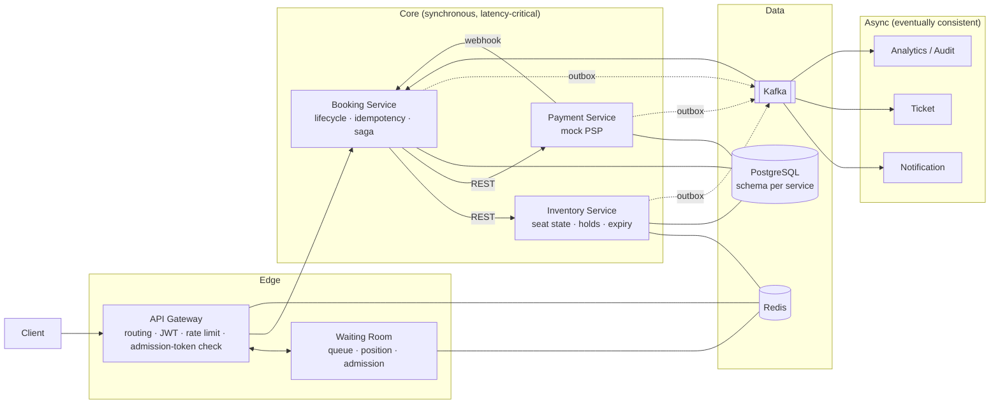
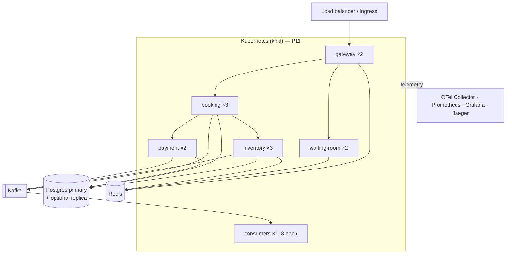

# 1. Architecture

## 1.1 Design drivers

The architecture follows from four facts:

1. **Contention, not volume, is the problem.** A hot sale has tens of thousands of users competing for the same few thousand rows.
2. **Correctness is non-negotiable.** Overselling or double charging is a business failure, not a degraded experience.
3. **Traffic is extremely bursty.** Near-zero load, then 100× normal in the first minute of a sale.
4. **Side effects are slow and unreliable.** Payments, emails and ticket generation must not block or break the booking.

| Driver | Architectural response |
|---|---|
| Contention | One authoritative store with short atomic compare-and-set transactions; partition by `event + section` for hot events |
| Correctness | PostgreSQL as single source of truth; invariants enforced by constraints and conditional updates, not application checks |
| Burstiness | Admission control (virtual waiting room) and rate limiting *before* the booking path; Redis absorbs the polling load |
| Slow side effects | Asynchronous, event-driven consumers fed by a transactional outbox; Saga for the payment flow |

## 1.2 Component view

### 1.2b Stage 1: modular monolith (ADR 002)

The component view above is the **target**. Until extraction (P7.8–P7.9), Booking, Inventory and Payment run as **modules inside one deployable, `ticketing-app`**. The boundaries stay the same:

| Boundary rule | Stage 1 (modules) | Stage 2 (services) |
|---|---|---|
| Data ownership | Separate schema and DB user per module | Unchanged |
| Synchronous calls | Java port interfaces (`InventoryApi`, `PaymentApi`), in-process adapter | Same interfaces, HTTP adapter with timeouts, retries, circuit breaker |
| Asynchronous events | Outbox per module → Kafka | Unchanged |
| Enforcement | Maven module dependencies + ArchUnit rules in CI | Process boundary |

**Why:** the hard part of this system is correctness under contention (§1.1). Proving it in one process first removes network failure modes from early debugging. Keeping ports and schemas separate means extraction later is a swap of adapters, not a rewrite. Extraction then happens because measurements justify it (P7.7).

## 1.3 Responsibilities and boundaries

| Component | Owns | Does **not** do | Built in |
|---|---|---|---|
| API Gateway | Routing, authN, per-user/IP rate limits, admission-token verification, correlation IDs | Business logic | P6.1–P6.3 |
| Waiting Room | Per-event FIFO queue, position/ETA, admission rate, signed admission tokens | Seat logic | P6.4–P6.7 |
| Booking Service | Booking aggregate, idempotency keys, saga state, booking outbox | Seat locking (delegates to Inventory) | P3, P4 |
| Inventory Service | Catalog (venues, sections, seats, events, shows), show seats, holds, seat state machine, expiry, inventory outbox | Payments, users | P1, P2, P6.9 |
| Payment Service | Payment intents, capture/refund, webhooks; `PaymentGateway` port (mock with failure injection, sandbox); reconciliation of `UNKNOWN` payments | Booking state | P4.1–P4.3, P4.8 |
| Notification / Ticket / Analytics | Their own read models and side effects | Anything on the critical path | P5.6–P5.8 |

**Boundary rule:** each service owns its schema; no service reads another service's tables. Cross-service data flows only through APIs or events. This keeps services independently deployable and lets ownership be explained cleanly in a review.

## 1.4 Communication styles

| Interaction | Style | Why |
|---|---|---|
| Client → Gateway → Booking | Synchronous REST | User needs an immediate answer: seat held or not |
| Booking → Inventory (hold/confirm/release) | Stage 1: in-process call through `InventoryApi`. Stage 2: synchronous REST with timeouts, retries (idempotent ops only), circuit breaker | Hold result decides the response; must be fast and explicit |
| Booking → Payment (create intent) | Stage 1: in-process through `PaymentApi`. Stage 2: synchronous REST | Client needs the payment token |
| Payment → external PSP | `PaymentGateway` port; mock or sandbox adapter | Same core code in tests, chaos runs and against a real test-mode API |
| Inventory → seat-map viewers | WebSocket push from `seat.updates` (P5.11) | Live map without polling; informational only |
| Payment → Booking (capture result) | Webhook (async callback), idempotent | Real PSPs work this way; capture can take seconds |
| Booking/Inventory → others | Kafka events via outbox | Side effects must not block or fail the booking |
| Waiting-room polling | Redis reads only | ~20k req/s must never reach Postgres |

**Why not all-async (choreography everywhere)?** The hold step needs an immediate yes/no for the user, and the money flow benefits from one place (the saga orchestrator) where its state is visible. Choreography is used only for side effects that have no compensations. Reasoning recorded in ADR 004 (P4.7).

**Why not gRPC between services?** REST/JSON is enough at this scale and easier to inspect in a demo; gRPC would be the upgrade if inter-service latency became the bottleneck.

## 1.5 Deployment view

- **All application services are stateless** → any replica can serve any request; killing one is safe (demonstrated in P10.1).
- **Stateful components** (Postgres, Redis, Kafka) run as single instances locally; production would use managed/replicated versions. This is stated honestly in the results rather than hidden.
- During development the same topology runs under Docker Compose.

## 1.6 Scaling strategy

| Layer | How it scales | Limit / next step |
|---|---|---|
| Gateway, Booking, Payment | Horizontal replicas behind the load balancer | DB connections — controlled by pool size per replica |
| Inventory | Horizontal replicas; writes partitioned by `show_id + section` | Hot-row contention — mitigated by admission control and section partitioning (P7) |
| Waiting room | Redis sorted set per event; stateless admission workers | Single Redis key per event — shard by event; acceptable at target scale |
| Kafka consumers | Consumer groups; parallelism = partition count | Increase partitions per topic |
| PostgreSQL | Vertical first; read replica for seat-map reads; table partitioning | Sharding by event as the documented future step |

## 1.7 Security (kept deliberately minimal)

- JWT validated at the gateway; services trust the gateway-injected user ID on an internal network (P6.2).
- Admission tokens are signed (HMAC), short-lived, bound to `userId + showId` — cannot be shared or forged (P6.5).
- Payment webhooks are signed and verified (P4.3).
- Secrets via environment variables / Kubernetes Secrets; never committed.
