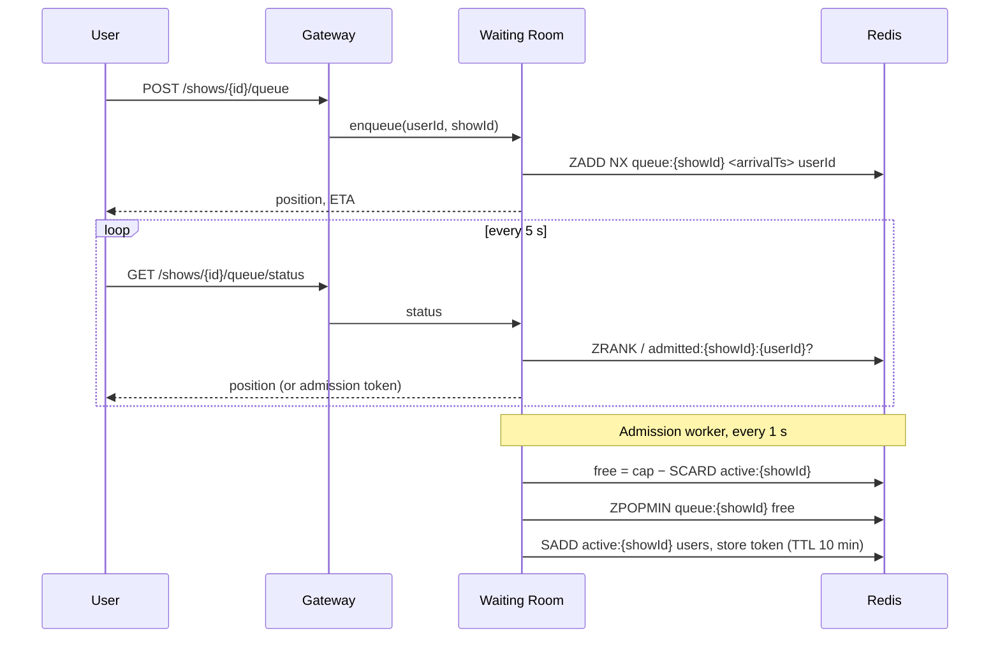
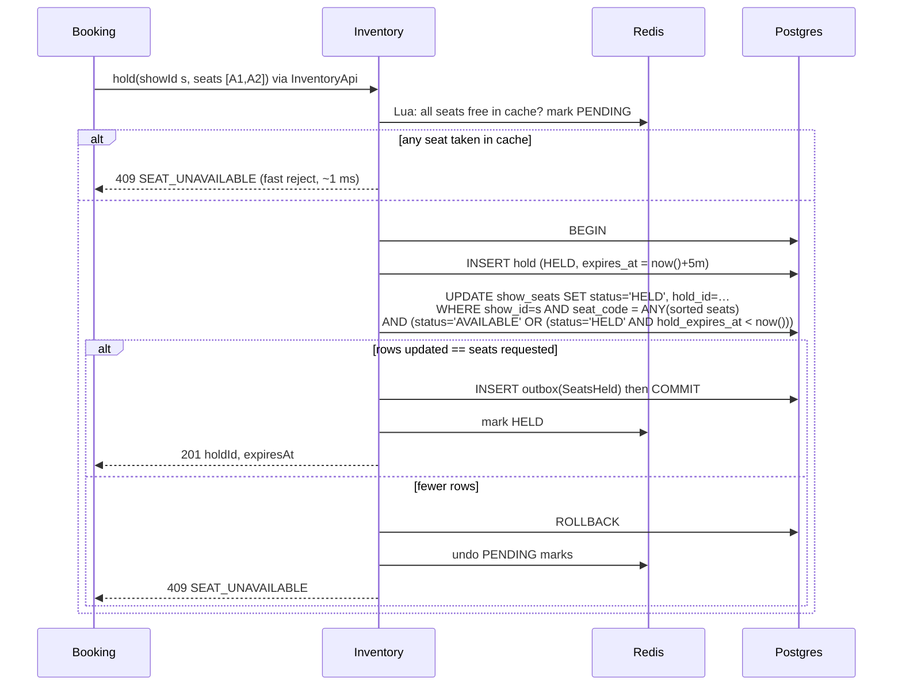
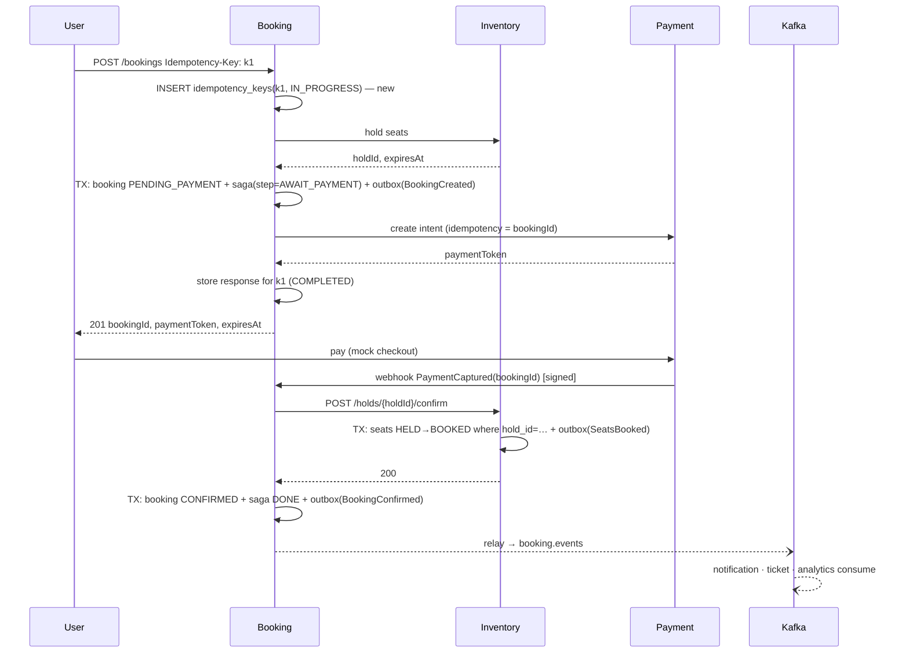
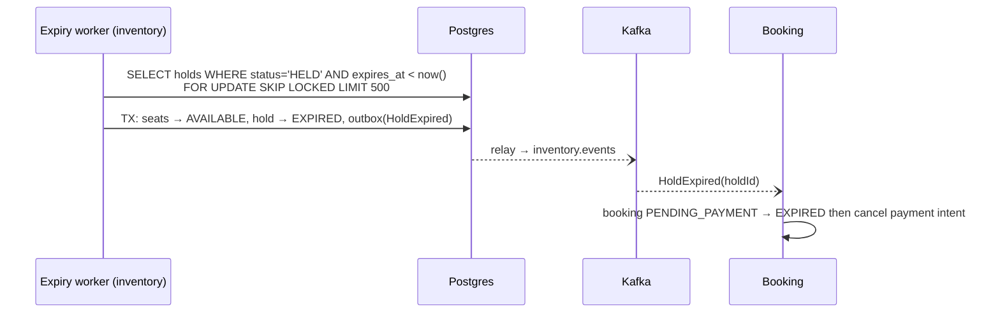
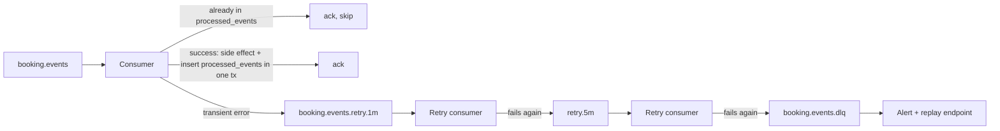
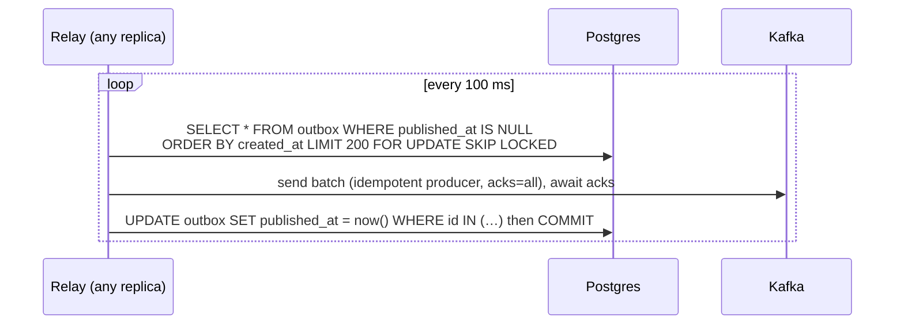
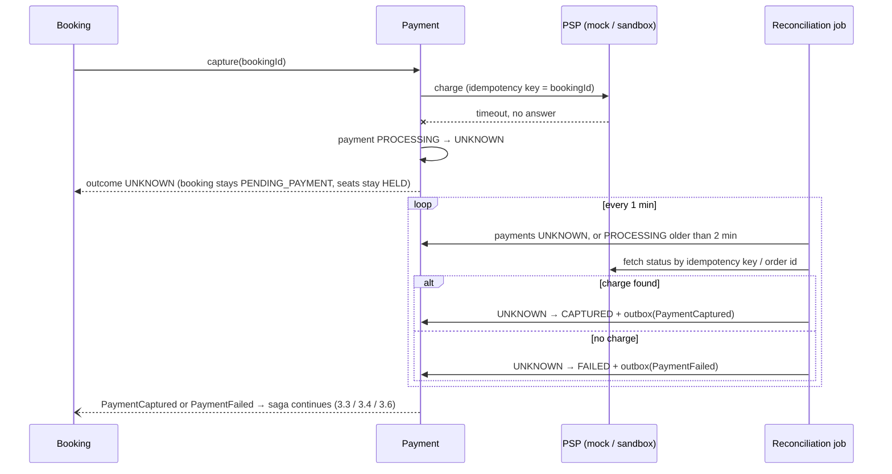

# 3. Request flows

Each flow lists the steps, the guarantee it provides, and what happens on failure. Plan part tags show where it is built. In stage 1 (ADR 002) arrows between Booking, Inventory and Payment are in-process port calls; in stage 2 the same arrows become HTTP calls.

---

## 3.1 Joining the waiting room and being admitted (P6.4–P6.5)

- **Guarantee:** FIFO by arrival time; one entry per user (`ZADD NX`); never more than `cap` active sessions.
- **Admission token:** HMAC-signed `{userId, showId, exp}`; the gateway verifies it **statelessly** on every booking call — no Redis lookup on the hot path.
- **Failure:** Redis down → waiting room returns `503 Retry-After`; booking path stays closed for that event rather than letting the full crowd through (fail closed protects correctness and the DB).

---

## 3.2 Holding seats (P1.1–P1.2, P2.4)

- **Guarantee:** all-or-nothing; a seat can be claimed by exactly one transaction because the `UPDATE`'s `WHERE` is re-evaluated under the row lock (compare-and-set). Losers see 0 rows instantly.
- **Why sorted seats:** two requests for `{A1,A2}` and `{A2,A1}` lock rows in the same order → no deadlock cycle.
- **Lazy expiry in the `WHERE`:** an expired hold is reclaimable immediately even if the expiry worker hasn't run → correctness never depends on worker timing.
- **Redis is only a filter.** If Redis wrongly says "free", Postgres still rejects. If Redis wrongly says "taken" (drift), the reconciliation job (P2.5) repairs it; worst case is a false rejection, never an oversell.

---

## 3.3 Booking and payment — success path (P3, P4)

---

## 3.4 Payment declined (P4.4)

1. Webhook `PaymentFailed(bookingId)` arrives.
2. Saga step → `COMPENSATING`; Booking calls `DELETE /holds/{holdId}` (idempotent).
3. Inventory: seats `HELD → AVAILABLE` (conditional on `hold_id`), outbox `HoldReleased`.
4. Booking: `PENDING_PAYMENT → FAILED`, outbox `BookingFailed`.
5. If the release call fails, the saga retries with exponential backoff; even if it never succeeds, the hold **expires on its own** after 5 minutes — compensation has a natural safety net.

---

## 3.5 Hold expires before payment (P2.1, P4.5)

- `SKIP LOCKED` lets several worker replicas process different batches without blocking each other.

---

## 3.6 Late payment — captured after expiry (P4.5)

1. Webhook `PaymentCaptured` arrives for a booking already `EXPIRED`.
2. Booking does **not** try to re-hold the seats (they may already belong to someone else).
3. Booking → `REFUND_PENDING`; calls Payment `refund(bookingId)` (idempotent).
4. On `RefundCompleted` → `REFUNDED`; outbox `BookingRefunded` → user notified.
- **Guarantee:** a customer is never charged without either a ticket or a refund (invariant 3).

---

## 3.7 Client retry after timeout (P3.4)

| Situation when retry with same key arrives | Response |
|---|---|
| Key not seen | Process normally |
| Key `COMPLETED`, same request hash | Return stored response (same `bookingId`) — no new booking |
| Key `IN_PROGRESS` (first request still running) | `409 Conflict` + `Retry-After: 1` |
| Key exists, **different** request hash | `422 Unprocessable` — key reuse with different body is a client bug |
| Key expired (> 24 h) | Treated as new |

---

## 3.8 Crash between payment capture and seat confirmation (P4.6)

1. Booking receives `PaymentCaptured`, persists saga step `CONFIRMING_SEATS`, then crashes before calling Inventory.
2. Payment service retries the webhook (at-least-once) **and** the saga recovery job scans sagas stuck in a step past `next_retry_at`.
3. Whichever arrives first resumes the saga: `confirm hold` is idempotent, so a duplicate call is harmless.
4. If the hold expired in the meantime → falls into the late-payment path (3.6).

---

## 3.9 Event consumption with retry and DLQ (P5.5, P5.9)

- Retries go to separate topics so one poison message doesn't block the partition (non-blocking retry).
- DLQ non-empty raises an alert (P8.7); messages can be replayed after a fix.

---

## 3.10 Outbox relay (P5.3)

- Crash after send but before `UPDATE` → events re-sent on next poll → **duplicates are possible, loss is not.** Consumers dedupe by `eventId`.

---

## 3.11 Payment outcome unknown: gateway timeout and reconciliation (P4.8) *(rev)*

- **Why not treat a timeout as failure?** The charge may have succeeded. Releasing the seats would then leave a customer who paid with no ticket. Retrying the charge is only safe because it carries the same idempotency key. Asking the gateway is the authoritative answer.
- **If the hold expired while the payment was `UNKNOWN`:** a later `CAPTURED` simply follows the late-payment refund path (3.6). Invariant 3 holds without extending holds.
- **Guarantee:** no payment stays `UNKNOWN` past the reconciliation window (default 15 min). After that, an alert fires for manual review (invariant 5).

---

## 3.12 User cancels a pending booking (P3.7) *(rev)*

1. `POST /bookings/{id}/cancel`. Allowed only in `PENDING_PAYMENT`; repeating it returns the same result.
2. Booking → `CANCELLED`; the saga runs the compensations: release the hold (`DELETE /holds/{id}`) and cancel the payment intent.
3. If a capture still arrives afterwards (the user paid in another tab), the booking goes `CANCELLED → REFUND_PENDING → REFUNDED`. This is the same path as a late payment.
