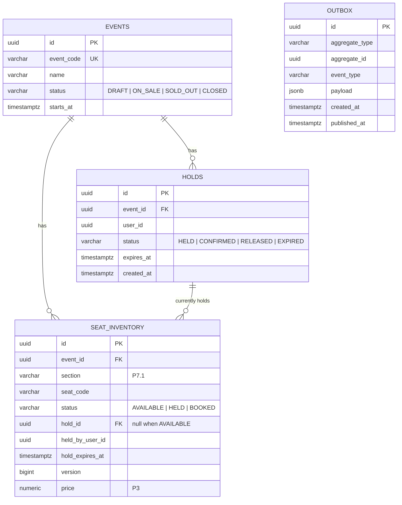
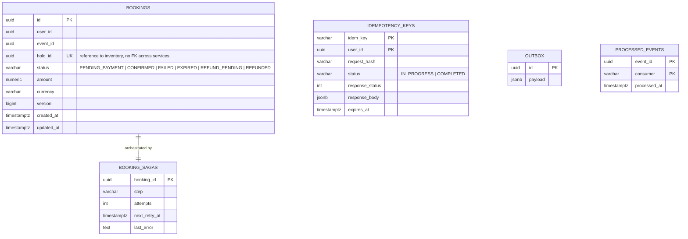

# 4. Data model

One PostgreSQL instance, **one schema per service** (`inventory`, `booking`, `payment`, `notification`, …). Each service connects with its own DB user that can only access its own schema. This gives database-per-service ownership without running many Postgres containers on a laptop; splitting into separate instances later is a configuration change.

> Current state: `inventory-service` V1 migration uses the default schema. Moving it to an `inventory` schema happens with the next inventory migration (P1).

## 4.1 Inventory schema (inventory-service)



| Constraint / index | Enforces / serves |
|---|---|
| `UNIQUE (event_id, seat_code)` | A seat exists once per event — the row is the unit of locking |
| `CHECK (status <> 'AVAILABLE' OR hold_id IS NULL)` *(P1.3)* | No "available but held" ghost state |
| `CHECK (status <> 'HELD' OR hold_expires_at IS NOT NULL)` *(P1.3)* | Invariant 4: every hold can expire |
| `idx_seat_inventory_lookup (event_id, status, seat_code)` | Seat-map reads and claim lookups |
| `idx_holds_expiry (status, expires_at)` | Expiry worker scan |
| `idx_outbox_unpublished (created_at) WHERE published_at IS NULL` *(P5.3)* | Partial index: relay scans only pending rows, stays small |

**Why one row per seat (not a counter)?** Reserved seating needs per-seat identity. For general admission (no seat numbers) the model would switch to a counter row per section (`UPDATE … SET available = available − n WHERE available >= n`) — the same compare-and-set idea. Noted as an extension.

## 4.2 Booking schema (booking-service, P3)



| Constraint / index | Enforces / serves |
|---|---|
| `UNIQUE (hold_id)` on bookings | One booking per hold — a duplicate saga can't create two bookings |
| `PRIMARY KEY (idem_key, user_id)` on idempotency_keys | Keys are scoped per user; the insert race is decided by the PK |
| `version` on bookings | Optimistic locking for concurrent webhook/expiry updates on the same booking |
| `idx_sagas_due (next_retry_at) WHERE step NOT IN ('DONE','COMPENSATED')` | Recovery job scan |
| `PRIMARY KEY (event_id, consumer)` on processed_events | Idempotent consumption |

## 4.3 Payment schema (payment-service, P4)

| Table | Key columns | Constraint that matters |
|---|---|---|
| `payments` | `id, booking_id, status (CREATED/CAPTURED/FAILED/REFUNDED), amount, provider_ref` | **`UNIQUE (booking_id)`** → at most one payment per booking → no double charge |
| `refunds` | `id, payment_id, status, amount` | `UNIQUE (payment_id)` → one refund per payment |
| `webhook_deliveries` | `id, payment_id, event_type, delivered_at, attempts` | Drives at-least-once webhook retries |

## 4.4 Consumer schemas (P5)

| Service | Tables |
|---|---|
| notification | `processed_events`, `notifications (booking_id, channel, status)` |
| ticket | `processed_events`, `tickets (id, booking_id, seat_code, qr_payload)` with `UNIQUE (booking_id, seat_code)` |
| analytics | `processed_events`, `booking_stats (event_id, minute, holds, bookings, failures)`, `audit_log` (append-only) |

## 4.5 Redis keys

| Key | Type | TTL | Purpose |
|---|---|---|---|
| `queue:{eventId}` | ZSET (score = arrival ts) | sale duration | Waiting-room FIFO |
| `active:{eventId}` | SET | — (members removed on exit/timeout) | Admitted sessions count |
| `admission:{eventId}:{userId}` | STRING (token) | 10 min | Token for polling clients |
| `seats:{eventId:section}` | HASH seat → state | — | Availability cache / fast reject |
| `rl:user:{userId}`, `rl:ip:{ip}` | HASH (tokens, ts) | 2× refill window | Token bucket |

Braces (`{…}`) are Redis Cluster hash tags: all keys of one event/section land in the same slot so Lua scripts touching them stay atomic (P7.2).

## 4.6 Kafka event envelope (P5.1)

```json
{
  "eventId": "uuid",
  "eventType": "BookingConfirmed",
  "schemaVersion": 1,
  "aggregateType": "Booking",
  "aggregateId": "uuid",
  "occurredAt": "2026-11-14T10:15:30Z",
  "traceId": "otel trace id",
  "payload": { "bookingId": "…", "userId": "…", "eventId": "…", "seats": ["A1","A2"], "amount": 4000 }
}
```

- `eventId` → consumer dedup key. `schemaVersion` → consumers handle old and new shapes during upgrades (additive changes only). `traceId` → end-to-end tracing across Kafka.
