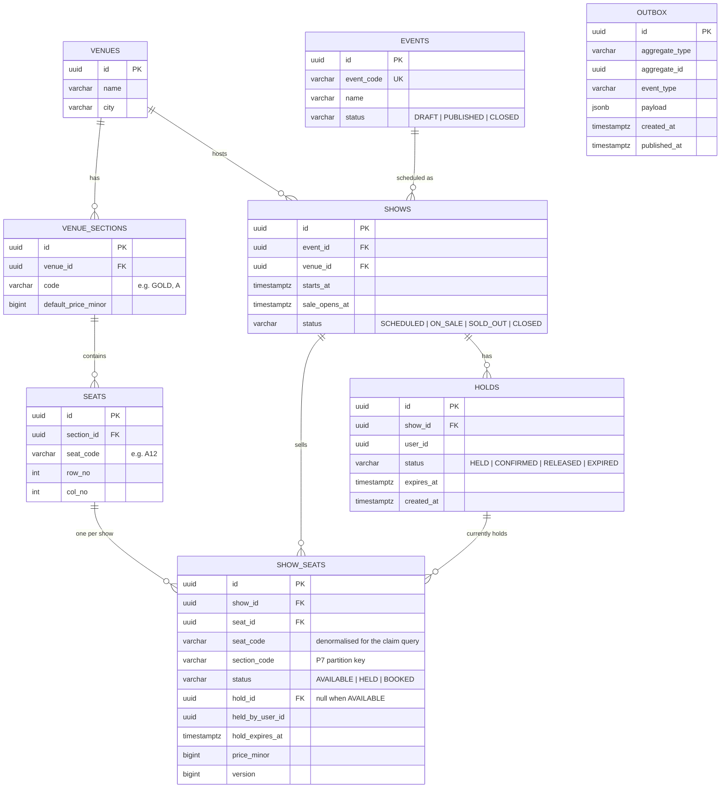
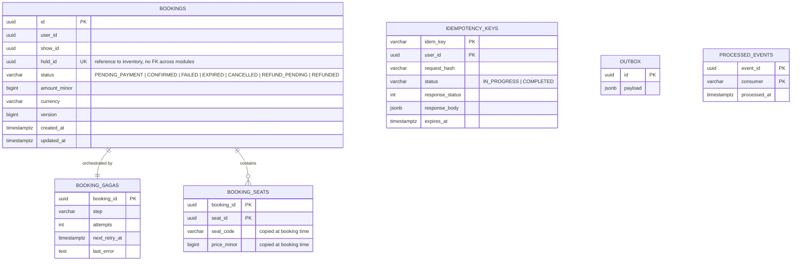

# 4. Data model

One PostgreSQL instance, **one schema per service** (`inventory`, `booking`, `payment`, `notification`, …). Each service connects with its own DB user that can only access its own schema. This gives database-per-service ownership without running many Postgres containers on a laptop; splitting into separate instances later is a configuration change.

> Current state: implemented by migration `V2__show_based_schema.sql` (P1.0) in the `inventory` schema, which also drops the V1 `public.events / holds / seat_inventory` demo tables. Flyway's history table stays in `public` until booking gets its own migrations (P3.1). The state `CHECK` constraints were added by `V3__show_seat_state_checks.sql` (P1.3). The planned `idx_show_seats_lookup` was not created: the `UNIQUE (show_id, seat_code)` index already serves both the claim and seat-map lookups, and a second index would only slow writes on the hottest table.

## 4.1 Inventory schema (inventory module) *(rev: Venue / Show model)*

The schema has two layers:

- **Catalog:** `venues → venue_sections → seats` describe the *physical* hall, written once per venue. `events → shows` describe *what* is on, and when and where.
- **Inventory:** `show_seats` is the *sellable* copy of every seat, **per show**. It is the row that is locked, held and booked. Creating a show (P6.9) inserts one `show_seats` row per venue seat, with the section's price.



| Constraint / index | Enforces / serves |
|---|---|
| `UNIQUE (show_id, seat_id)` on show_seats | A seat exists once per show. The row is the unit of locking (invariant 1) |
| `UNIQUE (show_id, seat_code)` on show_seats | Claim query by code needs exactly one row per code |
| `UNIQUE (section_id, seat_code)` on seats | Layout has no duplicate chairs |
| `ck_available_has_no_hold`: `CHECK (status <> 'AVAILABLE' OR (hold_id, held_by_user_id, hold_expires_at all NULL))` *(V3, P1.3)* | No "available but held" ghost state |
| `ck_held_has_hold_and_expiry`: `CHECK (status <> 'HELD' OR (hold_id, held_by_user_id, hold_expires_at all NOT NULL))` *(V3, P1.3)* | Invariant 4: every hold can expire |
| `ck_booked_has_hold`: `CHECK (status <> 'BOOKED' OR hold_id IS NOT NULL)` *(V3, P1.3)* | A booked seat traces back to its hold |
| `idx_show_seats_lookup (show_id, status, seat_code)` | Seat-map reads and claim lookups |
| `idx_holds_expiry (status, expires_at)` | Expiry worker scan |
| `idx_outbox_unpublished (created_at) WHERE published_at IS NULL` *(P5.3)* | Partial index: relay scans only pending rows, stays small |

**Why copy `seat_code`, `section_code` and `price` into `show_seats`?** The hot claim query (`UPDATE show_seats … WHERE show_id = ? AND seat_code = ANY(?)`) then touches one table and needs no join. The price is fixed per show when the show is created, so later layout or price edits don't change seats already on sale.

**Why one row per seat (not a counter)?** Reserved seating needs per-seat identity. For general admission (no seat numbers) the model would switch to a counter row per section (`UPDATE … SET available = available − n WHERE available >= n`) — the same compare-and-set idea. Noted as an extension.

## 4.2 Booking schema (booking module, P3)



| Constraint / index | Enforces / serves |
|---|---|
| `UNIQUE (hold_id)` on bookings | One booking per hold — a duplicate saga can't create two bookings |
| `PRIMARY KEY (idem_key, user_id)` on idempotency_keys | Keys are scoped per user; the insert race is decided by the PK |
| `PRIMARY KEY (booking_id, seat_id)` on booking_seats *(rev)* | A seat appears once per booking; the booking keeps its own copy of what was sold, so history reads never call inventory |
| `idx_bookings_user (user_id, created_at DESC)` *(rev)* | Booking history (P3.8) |
| `version` on bookings | Optimistic locking for concurrent webhook/expiry updates on the same booking |
| `idx_sagas_due (next_retry_at) WHERE step NOT IN ('DONE','COMPENSATED')` | Recovery job scan |
| `PRIMARY KEY (event_id, consumer)` on processed_events | Idempotent consumption |

## 4.3 Payment schema (payment module, P4)

| Table | Key columns | Constraint that matters |
|---|---|---|
| `payments` | `id, booking_id, status (INITIATED/PROCESSING/CAPTURED/FAILED/UNKNOWN/REFUNDED), amount_minor, gateway (MOCK/SANDBOX), gateway_ref, idempotency_key, updated_at` *(rev)* | **`UNIQUE (booking_id)`** → at most one payment per booking → no double charge. `idx_payments_reconcile (status, updated_at) WHERE status IN ('UNKNOWN','PROCESSING')` → reconciliation scan (P4.8) |
| `refunds` | `id, payment_id, status, amount` | `UNIQUE (payment_id)` → one refund per payment |
| `webhook_deliveries` | `id, payment_id, event_type, delivered_at, attempts` | Drives at-least-once webhook retries |

## 4.4 Consumer schemas (P5)

| Service | Tables |
|---|---|
| notification | `processed_events`, `notifications (booking_id, channel, status)` |
| ticket | `processed_events`, `tickets (id, booking_id, seat_id, qr_payload)` with `UNIQUE (booking_id, seat_id)` |
| analytics | `processed_events`, `booking_stats (show_id, minute, holds, bookings, failures)`, `audit_log` (append-only) |

## 4.5 Redis keys

| Key | Type | TTL | Purpose |
|---|---|---|---|
| `queue:{showId}` | ZSET (score = arrival ts) | sale duration | Waiting-room FIFO |
| `active:{showId}` | SET | — (members removed on exit/timeout) | Admitted sessions count |
| `admission:{showId}:{userId}` | STRING (token) | 10 min | Token for polling clients |
| `seatstate:{showId}` *(P2.3)* | HASH seat → `version\|A/H/B\|expiryMs` | — | Seat-map cache and fast-reject filter (P2.4); writes are version-guarded so events can arrive in any order |
| `seatstate:{showId}:ready` *(P2.3)* | STRING | — | Set after a full warm-up; readers ignore a show without it, so a half-loaded hash is never served |
| `rl:user:{userId}`, `rl:ip:{ip}` | HASH (tokens, ts) | 2× refill window | Token bucket |

Braces (`{…}`) are Redis Cluster hash tags: all keys of one show/section land in the same slot so Lua scripts touching them stay atomic (P7.2).

## 4.6 Kafka event envelope (P5.1)

```json
{
  "eventId": "uuid",
  "eventType": "BookingConfirmed",
  "schemaVersion": 1,
  "aggregateType": "Booking",
  "aggregateId": "uuid",
  "occurredAt": "2026-11-14T10:15:30Z",
  "traceId": "otel trace id",
  "payload": { "bookingId": "…", "userId": "…", "showId": "…", "seats": ["A1","A2"], "amountMinor": 400000 }
}
```

- `eventId` → consumer dedup key. `schemaVersion` → consumers handle old and new shapes during upgrades (additive changes only). `traceId` → end-to-end tracing across Kafka.
