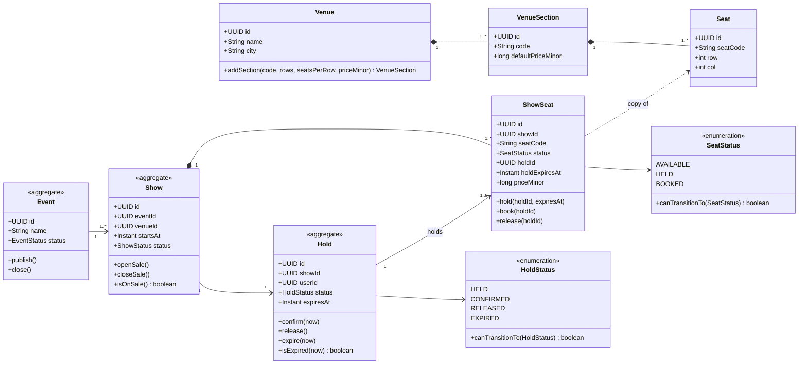
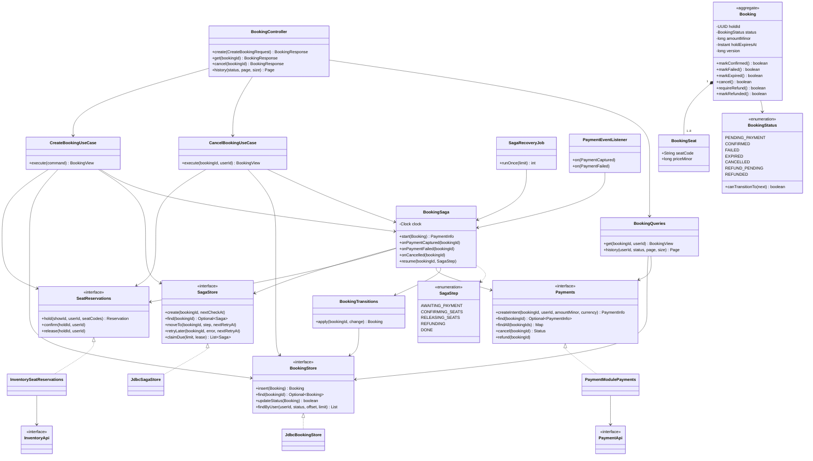
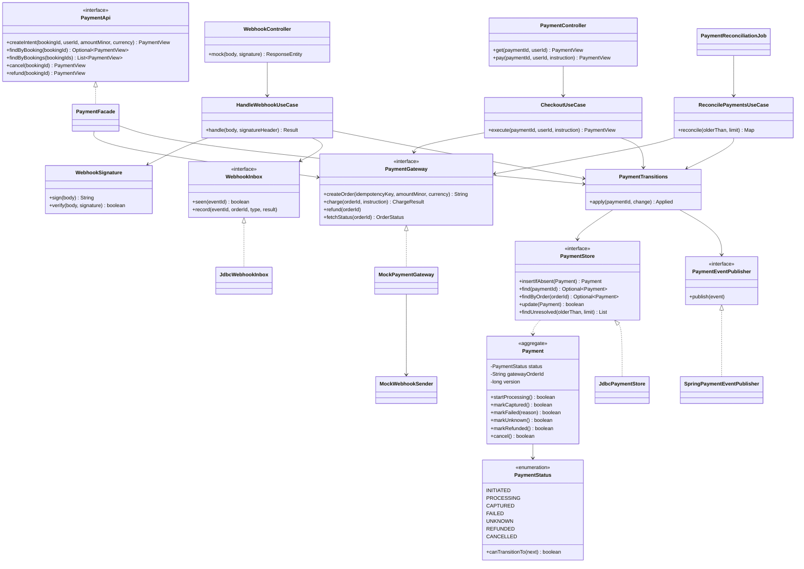
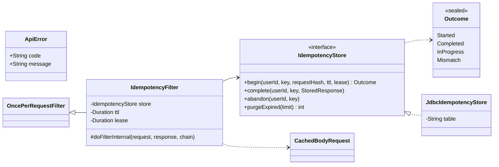
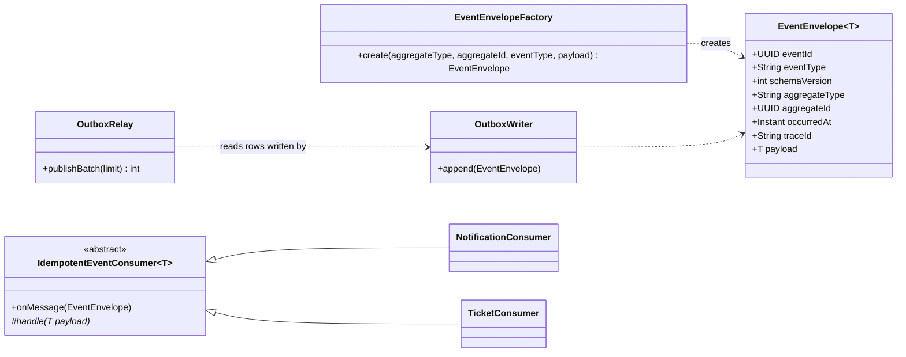
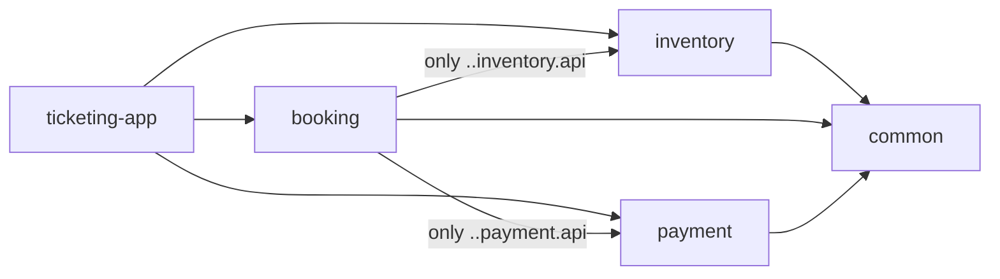

# Class diagrams

The class-level design of the three core modules and the shared `common` library. Sections 1–3 and 4.1 show the code **as built** (through Phase 4); classes still to come are marked ⬜ with their plan part, and §4.2 is the planned Phase 5 design. The code must match the diagram, or the diagram is updated in the same commit. The pattern names refer to [DESIGN_PATTERNS.md](DESIGN_PATTERNS.md); the principles to [SOLID.md](SOLID.md).

**Conventions**
- `<<interface>>` = a port (application layer) or a published module API.
- `<<aggregate>>` = a consistency boundary: changed only through its own methods, one transaction at a time.
- Domain classes have no Spring, JDBC or JPA imports (DIP). Persistence is plain JDBC in `infrastructure`, mapping rows to the domain classes.

---

## 1. Inventory module

### 1.1 Domain

- **State pattern:** `SeatStatus.canTransitionTo` and `HoldStatus.canTransitionTo` hold the legal transitions (plan §4.3). `ShowSeat` and `Hold` methods call them and throw `IllegalStateTransitionException` otherwise. (P1.3)
- **Why `ShowSeat` is not inside the `Hold` aggregate:** seats are claimed by a set-based conditional `UPDATE` for speed, not by loading aggregates. The aggregate methods are used in unit tests and the expiry/confirm paths; the hot claim path enforces the same rules in SQL.

### 1.2 Application layer and ports

```mermaid
classDiagram
    direction TB
    class InventoryApi {
      <<interface>>
      +hold(HoldCommand) HoldResult
      +confirm(holdId, userId) HoldResult
      +release(holdId, userId) HoldResult
      +get(holdId, userId) HoldResult
    }
    class CatalogAdminApi {
      <<interface>>
      +createVenue(CreateVenueCommand) VenueView
      +createEvent(CreateEventCommand) EventView
      +createShow(CreateShowCommand) ShowView
      +changeShowStatus(showId, ShowStatus) ShowView
    }
    class SeatMapQuery {
      <<interface>>
      +seatMap(showId, section) SeatMapView
    }
    class CatalogQuery {
      <<interface>>
      +listEvents(page, size) Page~EventView~
      +listShows(eventId) List~ShowView~
    }
    class CatalogReadStore {
      <<interface>>
      +publishedEvents(offset, limit) List~EventView~
      +showsOfPublishedEvent(eventId) Optional
      +seatMap(showId, section) Optional~SeatMapView~
    }
    CatalogQuery <|.. CatalogQueries
    SeatMapQuery <|.. CatalogQueries
    CatalogQueries --> CatalogReadStore
    CatalogReadStore <|.. JdbcCatalogReadStore
    CatalogReadStore <|.. CachedCatalogReadStore
    CachedCatalogReadStore o-- JdbcCatalogReadStore : decorates
    class FilteredCreateHold {
      -SeatFilter filter
      -CreateHoldUseCase createHold
      +execute(HoldCommand) HoldResult
    }
    class SeatFilter {
      <<interface>>
      +tryReserve(showId, seatCodes) Reservation
      +cancel(Reservation)
    }
    class CreateHoldUseCase {
      -ShowStore shows
      -SeatLockingStrategy locking
      -HoldStore holds
      -SeatEvents events
      +execute(HoldCommand) HoldResult
    }
    class ConfirmHoldUseCase {
      +execute(holdId, userId) HoldResult
    }
    class ReleaseHoldUseCase {
      +execute(holdId, userId) HoldResult
    }
    class ExpireHoldsJob {
      +runBatch(limit) int
    }
    class SeatLockingStrategy {
      <<interface>>
      +claim(showId, seatCodes, holdId, userId, expiresAt) ClaimResult
    }
    class ConditionalUpdateStrategy
    class PessimisticLockStrategy
    class OptimisticLockStrategy
    class RedisLockStrategy
    class RedisLuaStrategy
    class HoldStore {
      <<interface>>
      +createHeld(id, showId, userId, seatCodes, ttl) Hold
      +find(holdId) Optional~Hold~
      +lock(holdId) Optional~Hold~
      +saveStatus(Hold)
      +findExpired(limit) List~Hold~
    }
    class ShowStore {
      <<interface>>
      +find(showId) Optional~Show~
    }
    class ShowSeatStore {
      <<interface>>
      +bookSeatsOf(holdId) int
      +releaseSeatsOf(holdId) int
      +prices(showId, seatCodes) List~PricedSeat~
    }
    class DatabaseClock {
      <<interface>>
      +now() Instant
    }
    InventoryApi <|.. InventoryFacade
    InventoryFacade --> FilteredCreateHold
    FilteredCreateHold --> SeatFilter
    FilteredCreateHold --> CreateHoldUseCase
    SeatFilter <|.. RedisSeatFilter
    SeatFilter <|.. NoSeatFilter
    InventoryFacade --> ConfirmHoldUseCase
    InventoryFacade --> ReleaseHoldUseCase
    CreateHoldUseCase --> SeatLockingStrategy
    CreateHoldUseCase --> HoldStore
    SeatLockingStrategy <|.. ConditionalUpdateStrategy
    SeatLockingStrategy <|.. PessimisticLockStrategy
    SeatLockingStrategy <|.. OptimisticLockStrategy
    SeatLockingStrategy <|.. RedisLockStrategy
    SeatLockingStrategy <|.. RedisLuaStrategy
    HoldStore <|.. JdbcHoldStore
    ShowStore <|.. JdbcShowStore
    CreateHoldUseCase --> ShowStore
    ConfirmHoldUseCase --> HoldStore
    ConfirmHoldUseCase --> ShowSeatStore
    ConfirmHoldUseCase --> DatabaseClock
    ReleaseHoldUseCase --> ShowSeatStore
    ShowSeatStore <|.. JdbcShowSeatStore
    DatabaseClock <|.. JdbcDatabaseClock
    ExpireHoldsJob --> HoldStore
    ExpireHoldsJob --> ShowSeatStore
    ExpireHoldsJob --> InventoryEventPublisher
    class InventoryEventPublisher {
      <<interface>>
      +publish(domainEvent)
    }
    ScheduledHoldExpiry --> ExpireHoldsJob
```

| Class | Pattern / principle | Plan |
|---|---|---|
| `InventoryApi`, `CatalogAdminApi`, `SeatMapQuery` | Facade + ISP: booking sees only hold operations; admin and read paths are separate interfaces | `InventoryApi` ✅ P0.14, `SeatMapQuery` ✅ P1.5, `CatalogAdminApi` ⬜ P6.9 (not built yet) |
| `InventoryFacade` | Facade: the module's single entry point, delegating to one use case per operation (SRP) | P0.14 |
| `SeatLockingStrategy` + 5 implementations | Strategy + OCP; built by the `SeatLockingConfig` factory method; one contract suite for all (LSP); `RedisLuaStrategy` decorates `ConditionalUpdateStrategy` | P1.7 ✅ |
| `FilteredCreateHold` + `SeatFilter` ← `RedisSeatFilter` / `NoSeatFilter` | Fast-reject filter outside the transaction: Redis may refuse early, never grant; Postgres decides. `NoSeatFilter` is the Null Object when the fast path is off | P2.4 ✅ |
| `CachedCatalogReadStore` | Decorator over `JdbcCatalogReadStore`: seat states from Redis, falls back to Postgres on a miss or error (CQRS-lite read side) | P2.3 ✅ |
| `HoldStore` ← `JdbcHoldStore`, `ShowStore` ← `JdbcShowStore` | Repository behind a port (DIP); JDBC because every query needs explicit SQL and the DB clock (`createHeld` computes expiry in Postgres, SRS A3) | P1.3 ✅ |

---

## 2. Booking module (as built, P3–P4)

| Class | Pattern / principle | Plan |
|---|---|---|
| `Booking` + `BookingStatus` | State; optimistic `version` so concurrent webhook, expiry and cancel updates can't overwrite each other (`BookingTransitions` retries on a version conflict) | P3.2 ✅ |
| `BookingSaga` + `SagaStep` | Saga orchestrator. The saga decides the next step, `Booking` decides which transitions are legal, `SagaRecoveryJob` decides when to resume (SRP). The step is saved in `booking_sagas` before it runs; every step is idempotent | P4.4–P4.5 ✅ |
| `SeatReservations`, `Payments` | Booking's own outbound ports (DIP, ISP): only the operations booking needs. `InventorySeatReservations` and `PaymentModulePayments` adapt them to the other modules' published APIs in-process; an HTTP adapter replaces them on extraction (Adapter) | P3.3, P4.1 ✅; HTTP ⬜ P7.8 |
| `BookingStore`, `SagaStore` ← `JdbcBookingStore`, `JdbcSagaStore` | Repository behind a port. `claimDue` is a `FOR UPDATE SKIP LOCKED` work queue whose lease is `next_retry_at` pushed forward (competing consumers) | P3.3, P4.4 ✅ |
| `PaymentEventListener` | Observer: reacts to `PaymentCaptured` / `PaymentFailed`; payment never depends on booking | P4.4 ✅ |
| `BookingQueries` | Read side kept apart from commands; history uses the `BookingSeat` copies and never calls inventory | P3.8 ✅ |
| Idempotency | Not a booking class: the shared `IdempotencyFilter` from `common` (§4) is registered for `POST /api/v1/bookings` with `booking.idempotency_keys` | P3.4–P3.5 ✅ |

---

## 3. Payment module (as built, P4)

| Class | Pattern / principle | Plan |
|---|---|---|
| `PaymentApi` → `PaymentFacade` | Facade + ISP: booking sees intents, lookups, cancel and refund only; checkout is an HTTP endpoint, and the gateway stays internal | P4.1 ✅ |
| `PaymentGateway` ← `MockPaymentGateway` | Adapter + OCP: a real provider (Razorpay test mode) is a new adapter. The mock can succeed, decline, time out (money taken, answer lost) or be random, and `MockWebhookSender` posts signed webhooks, sometimes twice | P4.1 ✅; sandbox ⬜ |
| `Payment` + `PaymentStatus` | State; `UNKNOWN` is an explicit state, not a failure; `INITIATED → CANCELLED` when the hold expires unpaid | P4.2 ✅ |
| `PaymentTransitions` | The only place a status changes: version-checked update, and it publishes `PaymentCaptured` / `PaymentFailed` only when it really changed the status (SRP) | P4.2 ✅ |
| `HandleWebhookUseCase` + `WebhookSignature` + `WebhookInbox` | Idempotent receiver: HMAC-SHA256 signature checked in constant time, dedup by event id, stale events ignored | P4.3 ✅ |
| `ReconcilePaymentsUseCase` vs `PaymentReconciliationJob` | Reconciliation: asks the gateway (`fetchStatus`) about `UNKNOWN` / `PROCESSING` payments and records the answer, never charges or refunds by itself; the job only decides when (SRP) | P4.8 ✅ |
| Checkout idempotency | The shared `IdempotencyFilter` (§4) registered with `payment.idempotency_keys`, with no change to the filter (OCP) | P4.1 ✅ |

---

## 4. `common` library

### 4.1 Built (P3.4–P3.5)

| Class | Pattern | Plan |
|---|---|---|
| `IdempotencyFilter` + `IdempotencyStore` | Idempotency key: one atomic claim (`INSERT … ON CONFLICT DO UPDATE … WHERE expired OR lease lapsed`), stored responses replayed with `Idempotent-Replayed: true`, 409 while in progress, 422 on a reused key with a different body, 5xx abandoned | P3.4–P3.5 ✅ |
| `JdbcIdempotencyStore(table)` | One class, one table per module (`booking.idempotency_keys`, `payment.idempotency_keys`), so modules don't share data (OCP) | P3.5, P4.1 ✅ |
| `ApiError` | DTO: the one error body all modules return | P4.1 ✅ |

### 4.2 Planned (Phase 5)

| Class | Pattern | Plan |
|---|---|---|
| `EventEnvelopeFactory` | Factory: identical metadata on every event | P5.1 |
| `OutboxWriter` / `OutboxRelay` | Transactional Outbox | P5.2–P5.3 |
| `IdempotentEventConsumer` | Template Method: `onMessage` does dedup, then `handle`, then metrics; subclasses implement only `handle` | P5.5 |

---

## 5. Module dependency rules (enforced by ArchUnit, P0.14)

1. `booking` may depend on `inventory.api` and `payment.api` only, never on their `application`, `domain` or `infrastructure` packages.
2. `inventory` and `payment` never depend on `booking`. Booking reacts to their events instead, which keeps the dependency graph acyclic.
3. `..domain..` imports nothing from Spring, JPA or Jackson.
4. `common` depends on no module.
