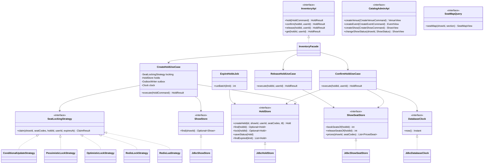
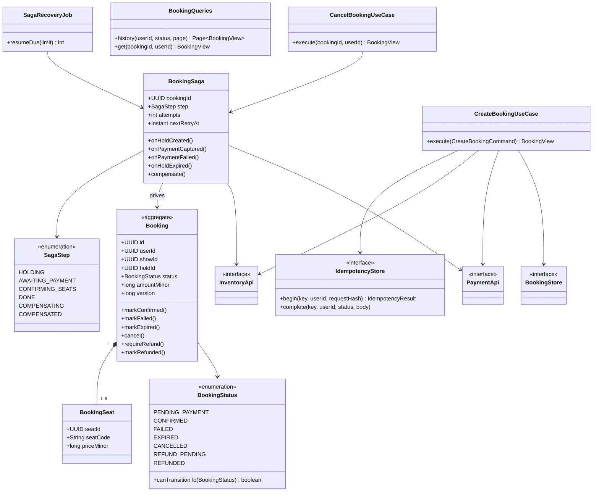
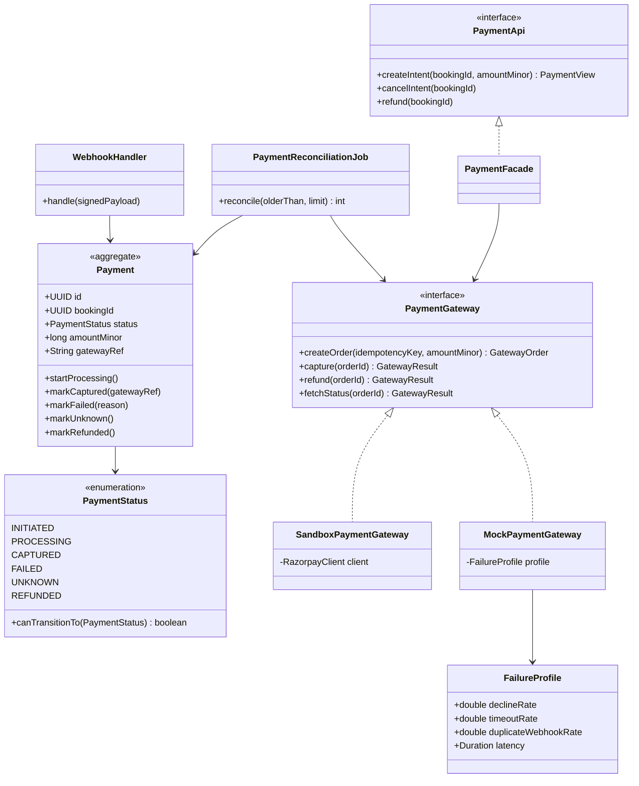
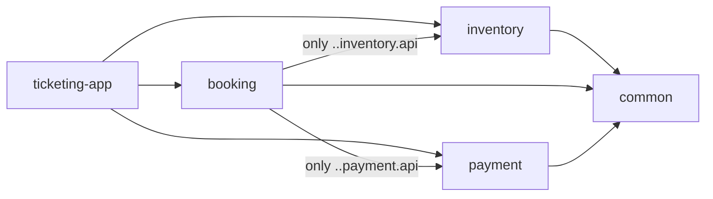

# Class diagrams (target design)

The class-level design of the three core modules and the shared `common` library. These diagrams are the **target**. Each class is built in the plan part noted next to it, and the code must match the diagram or the diagram is updated in the same commit. The pattern names refer to [DESIGN_PATTERNS.md](DESIGN_PATTERNS.md); the principles to [SOLID.md](SOLID.md).

**Conventions**
- `<<interface>>` = a port (application layer) or a published module API.
- `<<aggregate>>` = a consistency boundary: changed only through its own methods, one transaction at a time.
- Domain classes have no Spring or JPA imports (DIP). Persistence entities are separate classes in `infrastructure`.

---

## 1. Inventory module

### 1.1 Domain

- **State pattern:** `SeatStatus.canTransitionTo` and `HoldStatus.canTransitionTo` hold the legal transitions (plan §4.3). `ShowSeat` and `Hold` methods call them and throw `IllegalStateTransitionException` otherwise. (P1.3)
- **Why `ShowSeat` is not inside the `Hold` aggregate:** seats are claimed by a set-based conditional `UPDATE` for speed, not by loading aggregates. The aggregate methods are used in unit tests and the expiry/confirm paths; the hot claim path enforces the same rules in SQL.

### 1.2 Application layer and ports

| Class | Pattern / principle | Plan |
|---|---|---|
| `InventoryApi`, `CatalogAdminApi`, `SeatMapQuery` | Facade + ISP: booking sees only hold operations; admin and read paths are separate interfaces | P0.14, P1.5, P6.9 |
| `InventoryFacade` | Facade: the module's single entry point, delegating to one use case per operation (SRP) | P0.14 |
| `SeatLockingStrategy` + 5 implementations | Strategy + OCP; one contract test suite for all (LSP) | P1.7 |
| `HoldStore` ← `JdbcHoldStore`, `ShowStore` ← `JdbcShowStore` | Repository behind a port (DIP); JDBC because every query needs explicit SQL and the DB clock (`createHeld` computes expiry in Postgres, SRS A3) | P1.3 ✅ |

---

## 2. Booking module

| Class | Pattern / principle | Plan |
|---|---|---|
| `Booking` + `BookingStatus` | State; optimistic `version` for concurrent webhook/expiry updates | P3.2 |
| `BookingSaga` | Saga orchestrator: it decides the next step, while `Booking` decides which transitions are legal (SRP) | P4.4 |
| `IdempotencyStore` | Idempotency key behind a port; Postgres adapter (DIP) | P3.4 |
| `InventoryApi`, `PaymentApi` | Booking depends on interfaces only; the in-process adapter now, HTTP after extraction (DIP, Adapter) | P3.3, P7.8 |
| `BookingQueries` | Read side kept apart from commands; history never calls inventory (`BookingSeat` copies) | P3.8 |

---

## 3. Payment module

| Class | Pattern / principle | Plan |
|---|---|---|
| `PaymentGateway` + Mock/Sandbox | Adapter + OCP; shared contract tests keep the mock as strict as the sandbox (LSP) | P4.1 |
| `Payment` + `PaymentStatus` | State; `UNKNOWN` is an explicit state, not a failure | P4.2 |
| `WebhookHandler` | Idempotent receiver; verifies the signature, ignores stale transitions | P4.3 |
| `PaymentReconciliationJob` | Uses only `fetchStatus`; never charges or refunds by itself (SRP) | P4.8 |

---

## 4. `common` library

| Class | Pattern | Plan |
|---|---|---|
| `EventEnvelopeFactory` | Factory: identical metadata on every event | P5.1 |
| `OutboxWriter` / `OutboxRelay` | Transactional Outbox | P5.2–P5.3 |
| `IdempotentEventConsumer` | Template Method: `onMessage` does dedup, then `handle`, then metrics; subclasses implement only `handle` | P5.5 |

---

## 5. Module dependency rules (enforced by ArchUnit, P0.14)

1. `booking` may depend on `inventory.api` and `payment.api` only, never on their `application`, `domain` or `infrastructure` packages.
2. `inventory` and `payment` never depend on `booking`. Booking reacts to their events instead, which keeps the dependency graph acyclic.
3. `..domain..` imports nothing from Spring, JPA or Jackson.
4. `common` depends on no module.
