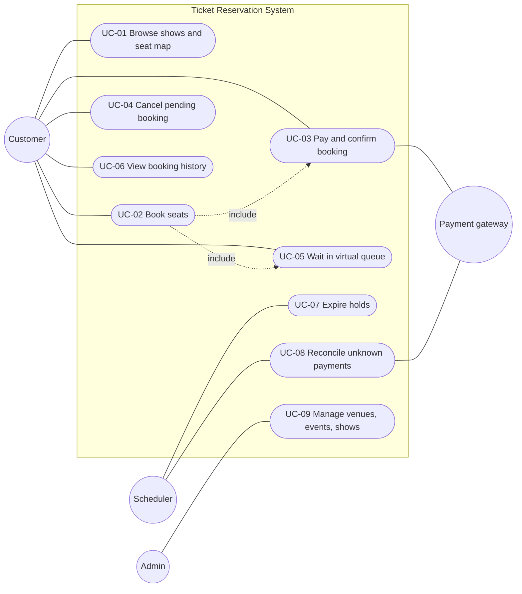
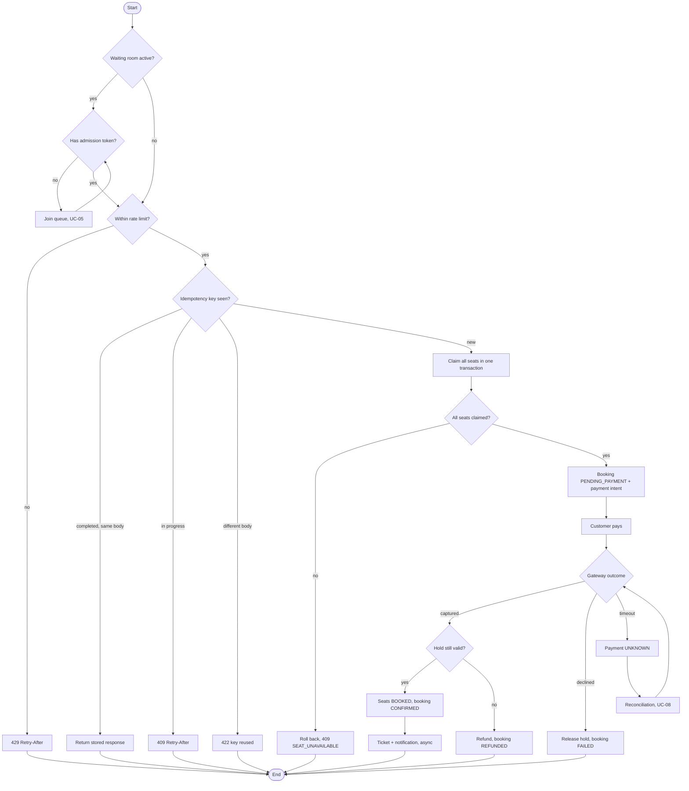
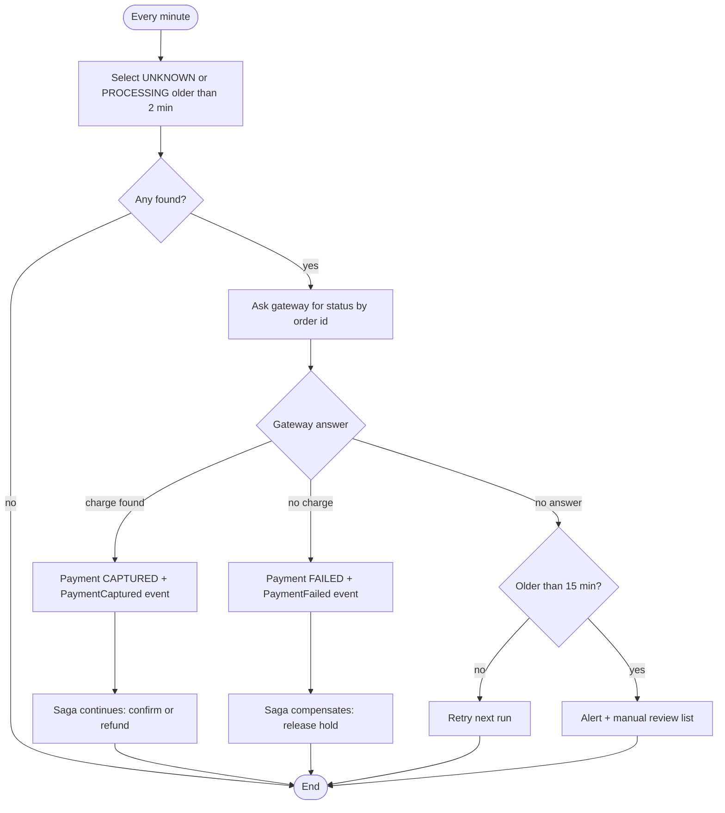
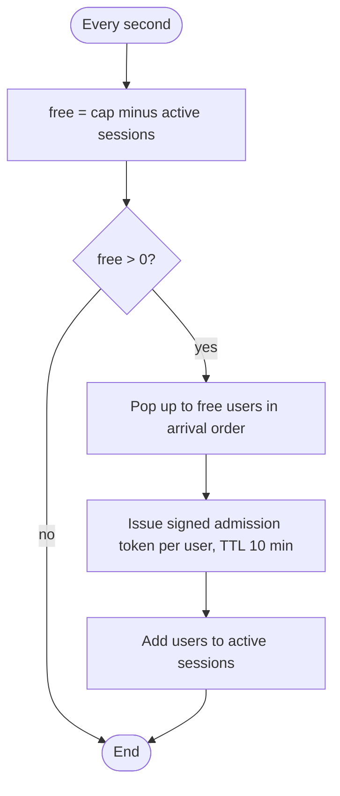
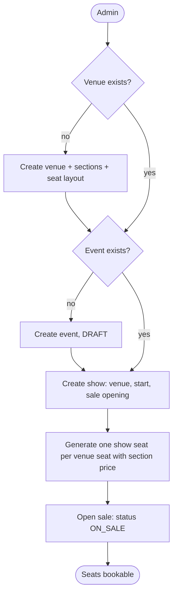

# Use cases and activity diagrams

Companion to the [SRS](SRS.md). Use cases say **what** each actor achieves. Activity diagrams show the **control flow**, including the branches where the hard problems (contention, unknown payment, expiry) appear. The sequence-level detail of each flow is in [HLD §3](../hld/03-request-flows.md).

> Mermaid has no native UML use-case diagram, so it is drawn as a flowchart: actors are on the outside and use cases are the rounded nodes inside the system boundary.

## 1. Use-case diagram

`UC-02 include UC-05` applies only while a show's waiting room is active (hot sale).

## 2. Use-case specifications

### UC-01 Browse shows and seat map
- **Actor:** Customer · **Requirements:** FR-01, FR-02, FR-15
- **Main flow:** list events → pick an event → list its shows → open a show's seat map (status + price per seat) → (optional) receive live updates.
- **Notes:** served from cache; may lag by < 1 s; a stale seat only causes a fast rejection on booking.

### UC-02 Book seats
- **Actor:** Customer · **Requirements:** FR-03, FR-05, FR-08, FR-10, FR-11 · **Pre:** authenticated; show `ON_SALE`; admission token if the waiting room is active
- **Main flow:** select 1–8 seats → submit with an `Idempotency-Key` → seats held atomically → booking `PENDING_PAYMENT` with payment details and hold expiry returned.
- **Alternatives:**
  - 2a. A seat is already taken: `409 SEAT_UNAVAILABLE`, nothing is held, and the user picks again.
  - 2b. Retry with the same key: the original response is returned.
  - 2c. Retry while the first request is still running: `409` with `Retry-After`.
  - 2d. The same key with a different body: `422`.
  - 2e. Rate limit exceeded: `429`.
  - 2f. No admission token during a hot sale: `403`, and the user joins the queue (UC-05).
- **Post:** seats `HELD` for 5 minutes for this user.

### UC-03 Pay and confirm booking
- **Actors:** Customer, Payment gateway · **Requirements:** FR-06, FR-07, FR-09, FR-12
- **Main flow:** the customer pays on the gateway checkout → the gateway sends a `captured` webhook → the seats are confirmed (`HELD → BOOKED`) → the booking becomes `CONFIRMED` → a ticket and a notification are produced asynchronously.
- **Alternatives:**
  - 3a. Payment declined: the hold is released and the booking becomes `FAILED`.
  - 3b. Gateway timeout: the payment becomes `UNKNOWN` and UC-08 resolves it.
  - 3c. Capture arrives after the hold expired or the booking was cancelled: automatic refund, booking `REFUNDED`.
  - 3d. Duplicate or out-of-order webhook: ignored by the state machine.
  - 3e. The app crashes after capture: saga recovery resumes the confirm step.

### UC-04 Cancel pending booking
- **Actor:** Customer · **Requirements:** FR-04, FR-13 · **Pre:** booking `PENDING_PAYMENT`
- **Main flow:** cancel → hold released, payment intent cancelled → booking `CANCELLED`.
- **Alternatives:**
  - 4a. The booking is already `CONFIRMED`, `FAILED` or `EXPIRED`: `409`.
  - 4b. Payment is captured afterwards: refund path (3c).

### UC-05 Wait in virtual queue
- **Actor:** Customer · **Requirements:** FR-10, NFR-07
- **Main flow:** join the queue for a show → see position and ETA (poll) → when admitted, receive an admission token valid for 10 minutes → continue to UC-02.
- **Alternatives:**
  - 5a. Joining twice: same position (one entry per user).
  - 5b. Redis unavailable: `503`, and the booking path stays closed for that show (fail closed).

### UC-06 View booking history
- **Actor:** Customer · **Requirements:** FR-13
- **Main flow:** list own bookings (newest first, filter by status) → open one to see seats, amount and payment status.

### UC-07 Expire holds
- **Actor:** Scheduler · **Requirements:** FR-04
- **Main flow:** every few seconds, find holds past `expires_at` (`SKIP LOCKED` batches) → seats `AVAILABLE`, hold `EXPIRED` → event `HoldExpired` → booking `EXPIRED`.
- **Note:** a new hold may reclaim an expired seat even before this job runs (lazy expiry in the claim query).

### UC-08 Reconcile unknown payments
- **Actors:** Scheduler, Payment gateway · **Requirements:** FR-09, NFR-11
- **Main flow:** every minute, select payments that are `UNKNOWN` or stuck in `PROCESSING` → ask the gateway for their status by order id → mark `CAPTURED` or `FAILED` → the saga continues.
- **Alternative:** 8a. Still unresolved after 15 minutes: alert, and the payment is listed for manual review.

### UC-09 Manage venues, events, shows
- **Actor:** Admin · **Requirements:** FR-14 · **Pre:** role `ADMIN`
- **Main flow:** create a venue with sections (rows × seats, default price) → create an event → schedule a show (venue, time, sale opening), which generates the show seats → open the sale (`ON_SALE`) → close it later.
- **Alternative:** 9a. Illegal status change (reopening a closed show): `409`.

---

## 3. Activity diagrams

### 3.1 Checkout: UC-02 + UC-03

### 3.2 Reconcile unknown payments: UC-08

### 3.3 Admit from virtual queue: UC-05

### 3.4 Schedule a show: UC-09

